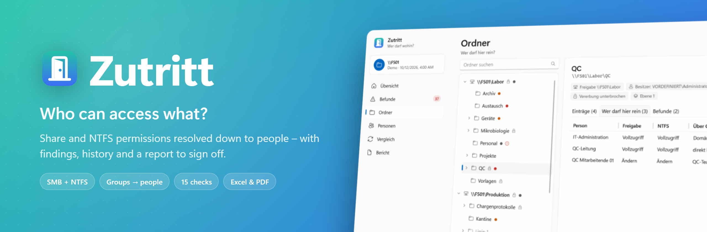
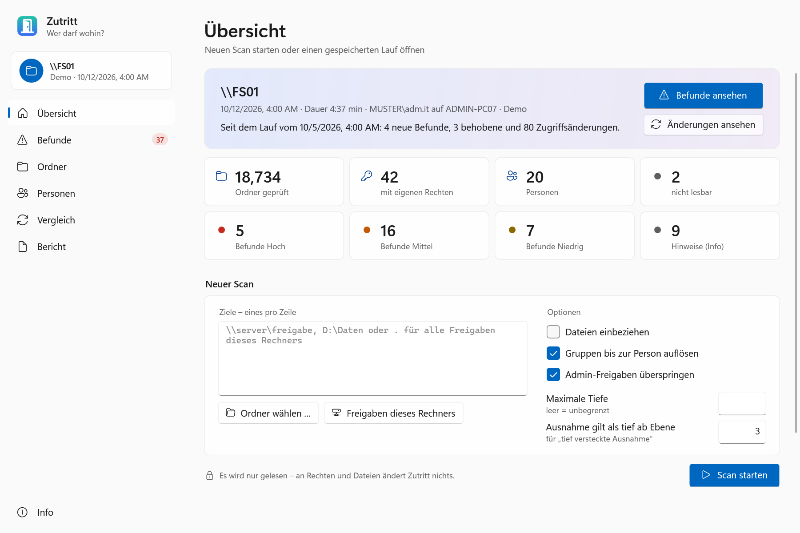
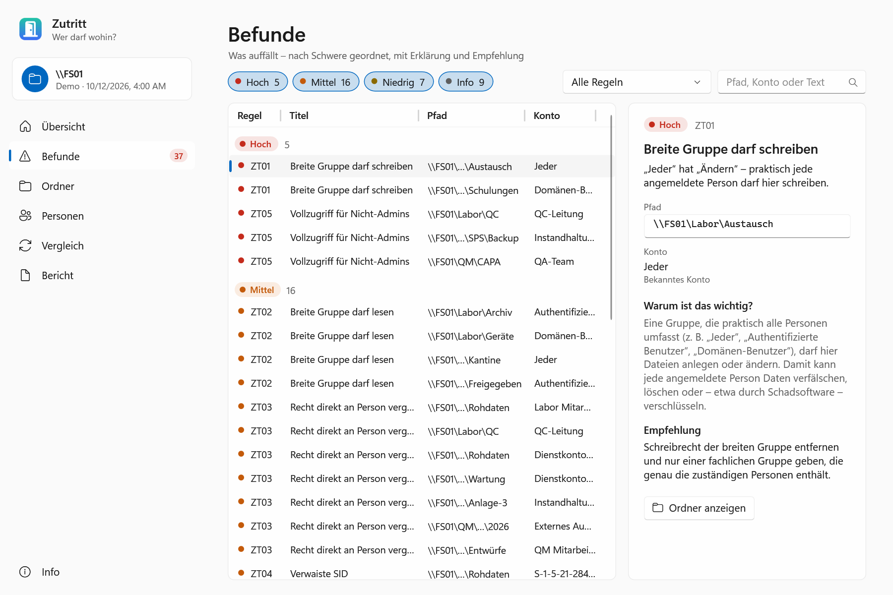
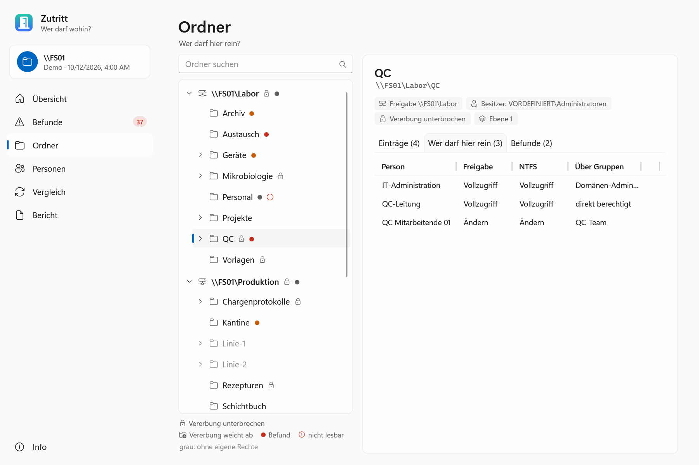
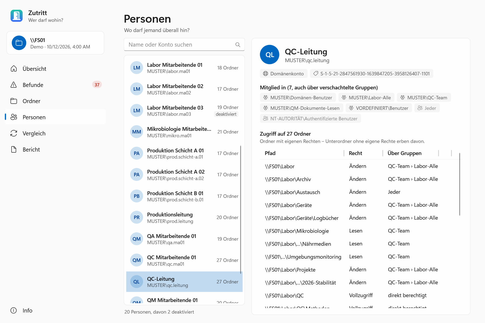
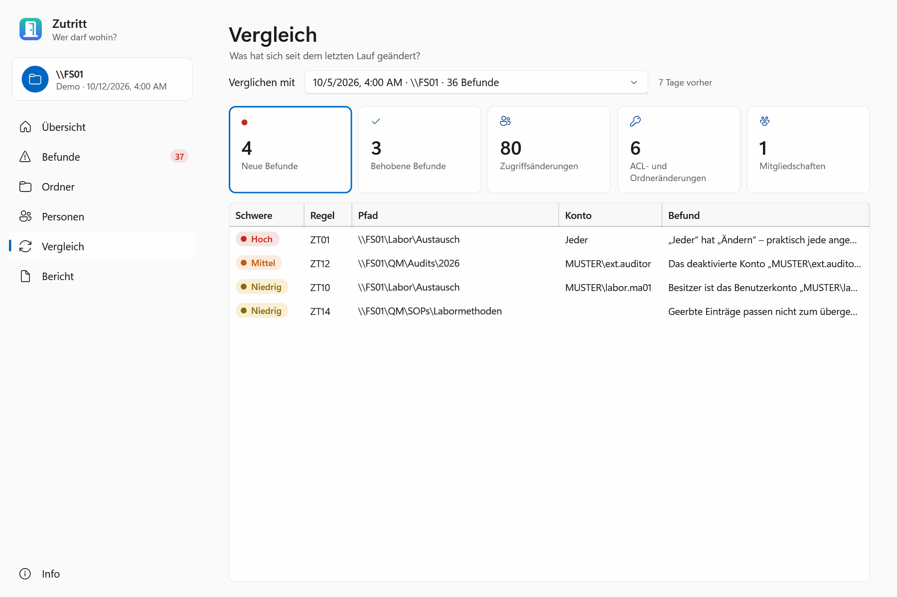
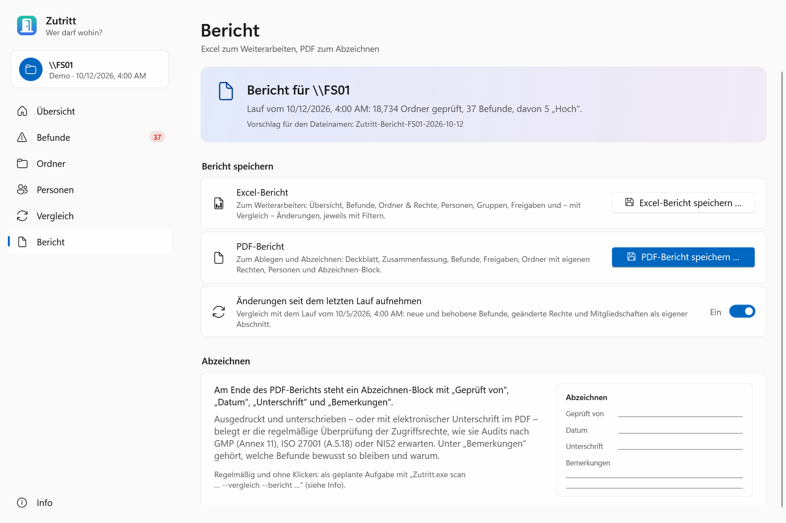

<p align="center">
  
</p>

<h1 align="center">Zutritt – Share Permissions <sub><i>(Freigaben-Rechte)</i></sub></h1>

<p align="center">
  <a href="https://github.com/ict-baden/zutritt/releases/latest"></a>
  
  
  
  
  
  
  
  <a href="https://github.com/ict-baden/zutritt/actions/workflows/build.yml"></a>
</p>

<p align="center">
  <b><a href="https://github.com/ict-baden/zutritt/releases/latest">Download</a></b>
  &nbsp;·&nbsp; <a href="#what-zutritt-does">Features</a>
  &nbsp;·&nbsp; <a href="#quick-start">Quick start</a>
  &nbsp;·&nbsp; <a href="#the-15-rules">Rules</a>
  &nbsp;·&nbsp; <a href="#documentation">Documentation</a>
  &nbsp;·&nbsp; <a href="#limits-honestly">Limits</a>
</p>

<br>

<p align="center">
  <b>Who can access what on your file shares – and through which group?</b><br>
  Zutritt reads SMB share permissions and NTFS ACLs, resolves groups down to individual people,<br>
  flags risky permissions and writes an Excel or PDF report you can sign off in an audit.
</p>

<p align="center">
  <sub>Read-only: Zutritt never changes permissions, files or accounts &nbsp;·&nbsp; no server, no agent, no service &nbsp;·&nbsp; one program for the desktop and for scheduled tasks</sub>
</p>

> [!NOTE]
> **Deutsch:** Zutritt zeigt, wer auf Dateifreigaben worauf zugreifen darf – und über welche Gruppe. Es liest Freigabe- und NTFS-Rechte, löst Gruppen bis zur einzelnen Person auf, meldet riskante Berechtigungen und schreibt einen Excel- oder PDF-Bericht zum Abzeichnen. Nur lesend, ohne Server und ohne Agent. Download: [aktuelle Version](https://github.com/ict-baden/zutritt/releases/latest) (MSI, [Zutritt.exe](https://github.com/ict-baden/zutritt/releases/latest/download/Zutritt.exe), ZIP). Oberfläche, Befehlszeile und Berichte gibt es auf Deutsch, Englisch, Spanisch, Französisch und Chinesisch (folgt Windows, umstellbar auf der Seite *Info*), diese Dokumentation ist englisch.
>
> **The application, its command-line output and the reports come in English, German, Spanish, French and Chinese (simplified)** – following the Windows display language, switchable on the *Info* page ([Languages](docs/usage.md#languages)). Spanish, French and Chinese are machine translations that have not been reviewed by native speakers yet. The screenshots in this documentation show the German interface and quote its labels, for example *Befunde* (findings) or *Wer darf hier rein* (who can get in here).

## What Zutritt does

<table>
  <tr>
    <td width="33%" valign="top">
      <picture>
        <source media="(prefers-color-scheme: dark)" srcset="docs/assets/screenshots/overview-dark.png">
        
      </picture>
      <br><b>Scan shares, servers and folders</b><br>
      <code>\\server\share</code>, a whole server, local folders or all shares of this PC. Junctions are recorded but not followed.
    </td>
    <td width="33%" valign="top">
      <picture>
        <source media="(prefers-color-scheme: dark)" srcset="docs/assets/screenshots/findings-dark.png">
        
      </picture>
      <br><b>15 rules with a clear recommendation</b><br>
      <i>Everyone</i> can write, orphaned SIDs, rights given to individuals, hidden inheritance breaks, moved folders – each with “why it matters”.
    </td>
    <td width="33%" valign="top">
      <picture>
        <source media="(prefers-color-scheme: dark)" srcset="docs/assets/screenshots/folders-dark.png">
        
      </picture>
      <br><b>Who can get in here?</b><br>
      Per folder, every person with the effective right over the share and over NTFS – and the group chain it comes through.
    </td>
  </tr>
  <tr>
    <td valign="top">
      <picture>
        <source media="(prefers-color-scheme: dark)" srcset="docs/assets/screenshots/people-dark.png">
        
      </picture>
      <br><b>Where can this person go?</b><br>
      Every folder a person can reach, the effective right and the groups behind it – including nested groups and disabled accounts.
    </td>
    <td valign="top">
      <picture>
        <source media="(prefers-color-scheme: dark)" srcset="docs/assets/screenshots/comparison-dark.png">
        
      </picture>
      <br><b>What changed since the last run?</b><br>
      New and resolved findings, changed ACL entries and group memberships, and who can now access more or less.
    </td>
    <td valign="top">
      <picture>
        <source media="(prefers-color-scheme: dark)" srcset="docs/assets/screenshots/report-dark.png">
        
      </picture>
      <br><b>Excel to work with, PDF to sign</b><br>
      Filterable Excel workbook with every entry; PDF with cover, summary, findings and a sign-off block for the access review.
    </td>
  </tr>
</table>

### And also

<table>
  <tr>
    <td width="50%" valign="top"><b>Effective access, computed like Windows</b><br>Stored ACE order (non-canonical lists included), deny entries, inheritance, <i>OWNER RIGHTS</i>, share ∩ NTFS – checked against the Windows access check in the test suite</td>
    <td width="50%" valign="top"><b>Groups down to people</b><br>Local accounts and groups of the scanned server and, on domain-joined PCs, Active Directory – nested, with cycle protection. Active Directory is so far tested against a simulated directory only (<a href="#limits-honestly">Limits</a>)</td>
  </tr>
  <tr>
    <td valign="top"><b>Orphaned is really orphaned</b><br>A SID is only reported as orphaned when the responsible account database was reachable and does not know the SID – an unreachable domain gives <i>Unbekannt</i> (unknown), not a deletion hint</td>
    <td valign="top"><b>Moved folders</b><br>Detects folders and files that carried their old inherited rights along when moved (ZT14) – usually invisible in Explorer</td>
  </tr>
  <tr>
    <td valign="top"><b>History per user</b><br>Every run is stored unchanged in a SQLite file under <code>%LocalAppData%\Zutritt</code> and can be reopened, compared and reported later</td>
    <td valign="top"><b>Command line and scheduled tasks</b><br><code>Zutritt.exe scan … --vergleich --bericht …</code> with exit codes 0–3 for monitoring</td>
  </tr>
</table>

## Quick start

<table>
  <tr>
    <td width="33%" valign="top"><b>① Download</b><br>MSI for all users, or the single <code>Zutritt.exe</code> that runs without installation and without a .NET runtime.</td>
    <td width="33%" valign="top"><b>② Scan</b><br>Enter <code>\\server</code>, <code>\\server\share</code>, <code>D:\Data</code> or <code>.</code> and click <i>Scan starten</i>. Nothing is changed.</td>
    <td width="33%" valign="top"><b>③ Review and sign</b><br>Work through <i>Befunde</i>, then save the PDF on the <i>Bericht</i> page and sign it.</td>
  </tr>
</table>

**① Download** – from the **[current release](https://github.com/ict-baden/zutritt/releases/latest)** (file names carry the version, e.g. `Zutritt-0.1.0-x64.msi`):

| File | What it is |
|---|---|
| **Zutritt-*version*-x64.msi** | Installer for all users: `C:\Program Files\Zutritt`, Start menu entry, no service, no autostart. No .NET runtime needed. Silent: `msiexec /i Zutritt-0.1.0-x64.msi /qn` – for Intune or GPO. |
| **[Zutritt.exe](https://github.com/ict-baden/zutritt/releases/latest/download/Zutritt.exe)** | A single file that runs without installation and without a .NET runtime. |
| Zutritt-*version*-win-x64-framework.zip | Small variant; needs the .NET 10 Desktop Runtime. |
| [SHA256SUMS.txt](https://github.com/ict-baden/zutritt/releases/latest/download/SHA256SUMS.txt) | Checksums of all files – the builds are not code-signed yet, so check them ([how](docs/installation.md#verifying-the-download)). |

The newest build of `main` is the pre-release [**latest**](https://github.com/ict-baden/zutritt/releases/tag/latest), with fixed file names (`Zutritt-x64.msi`, `Zutritt.exe` …) – for trying changes before the next version, not for production.

Want to look around without a file server? Start **`Zutritt.exe --demo`** – two built-in demo runs in a temporary database that is deleted when you close the window.

**② Scan** – Run Zutritt with an account that can read the permissions you want to see. For the share permissions of a server, that account needs administrator rights on the server; without them the share is reported as unreadable (ZT13) and access is rated by NTFS alone. Details: **[Installation & rights →](docs/installation.md)**

**③ Review and sign** – Each finding comes with an explanation and a recommendation. The PDF report ends with a block for *Geprüft von* (reviewed by), *Datum*, *Unterschrift* (signature) and *Bemerkungen* (remarks). Walkthrough: **[Using the app →](docs/usage.md)**

### From the command line

Command line: **`Zutritt.exe --hilfe`** lists every command and option, `Zutritt.exe --version` prints version and build. The same `Zutritt.exe` runs without a window when given a command – for example every Monday at 6:00 with a comparison and a PDF to sign:

```bat
schtasks /create /tn "Zutritt Wochenbericht" /sc weekly /d MO /st 06:00 /tr ^
  "\"C:\Program Files\Zutritt\Zutritt.exe\" scan \\FS01 --vergleich --bericht D:\Berichte\Zutritt.pdf"
```

| Exit code | Meaning |
|---|---|
| `0` | no findings of severity *Mittel* (medium) or higher |
| `1` | findings *Mittel*, none *Hoch* (high) |
| `2` | at least one finding *Hoch* |
| `3` | error or cancelled (also when a report could not be written) |

All commands, options, logging and encoding: **[Command line →](docs/command-line.md)**

## The 15 rules

ACL findings are reported where an entry is set explicitly – not again on every folder that inherits it.

| ID | Severity | Finding | German title in the app |
|---|---|---|---|
| [ZT01](docs/rules.md#zt01--broad-group-can-write) |  | A broad group (*Everyone*, *Authenticated Users*, *Domain Users* …) can write | *Breite Gruppe darf schreiben* |
| [ZT02](docs/rules.md#zt02--broad-group-can-read) |  | A broad group can read | *Breite Gruppe darf lesen* |
| [ZT03](docs/rules.md#zt03--right-granted-directly-to-a-person) |  | Right granted directly to a person instead of a group | *Recht direkt an Person vergeben* |
| [ZT04](docs/rules.md#zt04--orphaned-sid) |  | Orphaned SID (entry or owner points to a deleted account) | *Verwaiste SID* |
| [ZT05](docs/rules.md#zt05--full-control-for-non-admins) |  | Full control for an account or group that is not an administrator | *Vollzugriff für Nicht-Admins* |
| [ZT06](docs/rules.md#zt06--deeply-hidden-exception) |  | Inheritance broken deep in the tree | *Tief versteckte Ausnahme* |
| [ZT07](docs/rules.md#zt07--deny-entry) |  | Explicit deny entry | *Verweigern-Eintrag* |
| [ZT08](docs/rules.md#zt08--share-everyone-can-change) |  | Share permission gives *Everyone* or *Authenticated Users* at least *Change* | *Freigabe: alle dürfen ändern* |
| [ZT09](docs/rules.md#zt09--folder-not-readable) |  | Folder, file or target could not be read | *Ordner nicht lesbar* |
| [ZT10](docs/rules.md#zt10--owner-is-a-user-account) |  | Owner is a personal user account | *Besitzer ist ein Benutzerkonto* |
| [ZT11](docs/rules.md#zt11--empty-group-has-rights) |  | A group without members has rights | *Leere Gruppe berechtigt* |
| [ZT12](docs/rules.md#zt12--disabled-account-has-rights) |  | A disabled account has its own rights | *Deaktiviertes Konto berechtigt* |
| [ZT13](docs/rules.md#zt13--share-permissions-not-readable) |  | Share permissions could not be read | *Freigabe-Berechtigungen nicht lesbar* |
| [ZT14](docs/rules.md#zt14--permissions-differ-from-inheritance) |  | Inherited entries do not match the parent – typically a moved folder | *Rechte weichen von der Vererbung ab* |
| [ZT15](docs/rules.md#zt15--entries-not-in-canonical-order) |  | Entries not in canonical order (e.g. an allow before a deny) – Windows evaluates the stored order | *Einträge nicht in kanonischer Reihenfolge* |

Folders whose permissions Windows itself manages (owner *TrustedInstaller*, entries for app packages and capabilities) do not trigger the housekeeping rules ZT02, ZT03, ZT06, ZT10 and ZT14, nor ZT05 for the folder's owner. Every rule in detail: **[Rules reference →](docs/rules.md)**

## Compared with the alternatives

| | icacls / Get-Acl scripts + Excel | Commercial access-governance suites | Zutritt |
|---|---|---|---|
| Share **and** NTFS permissions | ◐ NTFS easy, share permissions need extra work | ✔︎ | ✔︎ |
| Groups resolved down to people | ✘ manual | ✔︎ | ✔︎ local SAM and AD of the scanning PC's domain |
| Effective access (deny, inheritance, share ∩ NTFS) | ✘ | ✔︎ | ✔︎ |
| Risk findings with recommendations | ✘ | ✔︎ | ✔︎ 15 fixed rules |
| Comparison with the previous run | ◐ diff by hand | ✔︎ | ✔︎ |
| Report to sign off | ◐ build it yourself | ✔︎ | ✔︎ PDF with sign-off block, Excel with filters |
| Change permissions, request and approval workflows | ✔︎ (icacls) | ✔︎ usually | ✘ deliberately read-only |
| Continuous monitoring, file-access auditing | ✘ | ◐ depends on the product | ✘ runs on demand or as a scheduled task |
| Server, database or agents to operate | ✘ | usually yes | ✘ one exe, a per-user SQLite file |
| Language | – | – | English, German, Spanish, French, Chinese |

<sub>✔︎ yes &nbsp;·&nbsp; ◐ partly or with effort &nbsp;·&nbsp; ✘ no. The commercial column describes the category in general, not a tested feature list of a specific product.</sub>

Zutritt answers one question well – *who can access what, and why* – for admins and auditors who need that answer regularly without introducing a new platform.

## Documentation

<table>
  <tr>
    <td width="50%" valign="top"><a href="docs/installation.md"><b>Installation &amp; rights</b></a><br><sub>MSI, single exe, ZIP, checksums and signatures, Intune and GPO, requirements, which rights the scanning account needs locally and on servers, updates</sub></td>
    <td width="50%" valign="top"><a href="docs/usage.md"><b>Using the app</b></a><br><sub>Every page with screenshots: overview and scan, findings, folders, people, comparison, report, info – the German labels of the screenshots explained</sub></td>
  </tr>
  <tr>
    <td valign="top"><a href="docs/command-line.md"><b>Command line</b></a><br><sub><code>scan</code>, <code>liste</code>, <code>bericht</code>, <code>--version</code>, <code>--info</code>, options, exit codes, scheduled tasks, logging and encoding</sub></td>
    <td valign="top"><a href="docs/rules.md"><b>Rules reference</b></a><br><sub>All 15 rules: what they mean, why they matter, what to do, and the deliberate exceptions</sub></td>
  </tr>
  <tr>
    <td valign="top"><a href="docs/how-it-works.md"><b>How it works</b></a><br><sub>Scanning, what gets stored, NT4-style ACLs, the effective-access algorithm, identities, comparison</sub></td>
    <td valign="top"><a href="docs/excel-and-pdf.md"><b>Reports: Excel &amp; PDF</b></a><br><sub>Excel sheets, PDF sections, the sign-off block, size limits and truncation</sub></td>
  </tr>
  <tr>
    <td valign="top"><a href="docs/data-and-privacy.md"><b>Data &amp; privacy</b></a><br><sub>What is read, what is stored where, the per-user database, log and diagnostics package, no data to ICT-Baden, handling reports confidentially</sub></td>
    <td valign="top"><a href="docs/limitations.md"><b>Limitations</b></a><br><sub>What Zutritt cannot see or decide – and how it errs on the side of showing more access</sub></td>
  </tr>
  <tr>
    <td colspan="2" valign="top"><a href="docs/development.md"><b>Development</b></a><br><sub>Building with .NET 10, tests on Windows (many need administrator rights) and Linux, architecture and platform split, CI and releases, third-party licences, MSI, regenerating the screenshots</sub></td>
  </tr>
</table>

## For audits

Periodic reviews of access rights are expected in GMP environments (EU GMP Annex 11, 21 CFR Part 11 context), under ISO/IEC 27001 (control A.5.18 *Access rights*) and NIS2. Zutritt produces the evidence for such a review: what was checked, by whom, when, with which result and what changed since last time – and a page to sign.

> [!CAUTION]
> Zutritt is **not a validated system** and makes no compliance claim. It is a read-only analysis tool; how it is qualified and used in a regulated process is up to the operator.

## Limits, honestly

- **Windows only, by design.** NTFS permissions, SMB share permissions (`NetShareEnum`, `NetShareGetInfo`), the local account databases of servers (SAM, LSA) and Active Directory are Windows concepts that only Windows APIs can read – so Zutritt is a Windows program. Its analysis core (rules, effective access, comparison, storage, reports) is platform-neutral and tested on Linux in CI; a front end on another platform over stored runs would be possible, scanning stays on Windows.
- **Rights of the scanning account matter.** Folders it cannot read are reported (ZT09); where a folder cannot even be listed, nothing below it is assessed. Share permissions need administrator rights on the server (ZT13).
- **Active Directory** is used only when the scanning PC is domain-joined, and only for its own domain. Groups from trusted domains are named but not expanded. AD lookups are tested against a simulated directory only, not yet against a real domain.
- **When in doubt, Zutritt shows more access, not less:** conditional allow entries count, conditional deny entries are ignored, unreadable share permissions mean “NTFS only”.
- **Files** are only examined with `--dateien` (*Dateien einbeziehen*), and then only files with their own permissions.
- **Very large reports** are truncated with a visible notice – the PDF earlier than the Excel workbook.
- **Pre-release, not code-signed yet.** Until Artifact Signing is set up, SmartScreen may warn; verify the downloads with `SHA256SUMS.txt` ([Installation › Verifying the download](docs/installation.md#verifying-the-download)).
- **A source that does not answer** – domain controller, account database, share listing – is given up after 60 seconds (accounts) or 2 minutes (shares) and reported, so the run still finishes.

Everything else: **[Limitations →](docs/limitations.md)**

## Build it yourself

```powershell
dotnet build Zutritt.sln
dotnet test Zutritt.sln     # many integration tests create shares and local accounts – run as administrator
dotnet publish src/Zutritt/Zutritt.csproj -c Release -r win-x64 -p:PublishSingleFile=true --self-contained false -o publish
```

On Linux or macOS the platform-neutral core and its tests build as well: `dotnet test tests/Zutritt.Tests -f net10.0`.

Needs the .NET 10 SDK (`global.json`: 10.0.100, roll forward to the latest feature band). MSI, CI, architecture and screenshots: **[Development →](docs/development.md)** · Contributing: **[CONTRIBUTING.md](CONTRIBUTING.md)** · Changes: **[CHANGELOG.md](CHANGELOG.md)**

<br>

<p align="center">
  <br>
  <sub><b>Zutritt</b> · Who can access what?</sub>
</p>

---

<!-- Impressum: dieselbe Adresse wie in der App (AppInfo.ImpressumUrl). -->
<sub>
Zutritt is free and open source software by <b>ICT-Baden</b>. &nbsp;·&nbsp;
Licence: <a href="LICENSE">MIT</a> &nbsp;·&nbsp;
Third-party licences: <a href="THIRD-PARTY-NOTICES.txt">THIRD-PARTY-NOTICES.txt</a> &nbsp;·&nbsp;
Support: free via GitHub, guaranteed with a <a href="SUPPORT.md">support contract</a> &nbsp;·&nbsp;
<a href="SECURITY.md">Security</a> &nbsp;·&nbsp;
<a href="https://ict-baden.de/">Website</a> &nbsp;·&nbsp;
<a href="https://ict-baden.de/impressum/">Impressum</a> &nbsp;·&nbsp;
<a href="https://ict-baden.de/datenschutz/">Datenschutz</a>
</sub>
