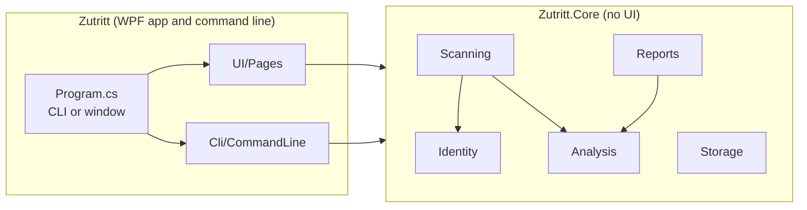

<sub><a href="../README.md">Zutritt</a> › <a href="../README.md#documentation">Documentation</a> › Development</sub>

# Development

Building, testing and releasing Zutritt, how the code is organised, and how the images in this documentation are made.

**Contents:** [Requirements](#requirements) · [Build](#build) · [Tests](#tests) · [Architecture](#architecture) · [Database schema](#database-schema) · [MSI](#msi) · [CI and releases](#ci-and-releases) · [Screenshots and images](#screenshots-and-images) · [Hidden switches](#hidden-switches)

## Requirements

- **.NET 10 SDK.** `global.json` pins `10.0.100` with `rollForward: latestFeature`, so newer 10.0 feature bands work too.
- **Windows** to run the app and the tests. The projects set `EnableWindowsTargeting`, so they can also be compiled elsewhere.
- **Administrator rights** for the full test suite (see [Tests](#tests)).
- For the MSI: nothing extra – the WiX Toolset comes as an MSBuild SDK (`WixToolset.Sdk` 5.0.2) via NuGet.

## Build

```powershell
dotnet build Zutritt.sln
dotnet run --project src/Zutritt -- --demo          # window with demo data
dotnet run --project src/Zutritt -- --hilfe         # command-line help
```

Release builds as the CI produces them:

```powershell
$common = 'src/Zutritt/Zutritt.csproj', '-c', 'Release', '-r', 'win-x64', '-p:PublishSingleFile=true', '-p:DebugType=none'
dotnet publish @common --self-contained false -o out/framework       # needs the .NET 10 Desktop Runtime
dotnet publish @common --self-contained true  -o out/self-contained  # basis of the MSI
dotnet publish @common --self-contained true -p:IncludeNativeLibrariesForSelfExtract=true `
               -p:EnableCompressionInSingleFile=true -o out/standalone  # the single Zutritt.exe
```

The version comes from `<Version>` in `src/Zutritt/Zutritt.csproj` (currently `1.0.0`); the CI overrides it with `-p:Version=…`.

## Tests

```powershell
dotnet test Zutritt.sln        # in an elevated terminal for the full suite
```

The xUnit project `tests/Zutritt.Tests` has about 1,100 tests. Many are **integration tests against the real Windows**: they create temporary folders with real ACLs, real SMB shares and real local users and groups, scan them and clean up afterwards. These tests are marked `[AdminFact]` and are **skipped without administrator rights** – run the suite elevated before you trust a green result. The CI runner runs as administrator.

Notable test groups:

| Tests | Check |
|---|---|
| `WindowsAccessCheckTests` | The computed effective rights match the Windows access check (AuthZ, `MAXIMUM_ALLOWED`) bit for bit, for a real local account in a real local group. |
| `Scanning/*` | ACL reading, NT4-style ACLs, inheritance expectation (ZT14), shares and share security, privileges (the tests remove or enable the backup privilege in a copied token, because an enabled one would bypass the ACLs under test). |
| `Analysis/*` | Rules on synthetic runs and on system folders (`FindingRulesSystemTests`), effective access, people access, comparison – including equivalence with the straightforward calculation and a time budget for large comparisons. |
| `Identity/*` | SID resolution against a fake directory, local accounts, well-known SIDs. Active Directory can only be tested for the case “no domain controller reachable” – there is no domain on the development machine. |
| `Storage/*`, `Reports/*` | Round trips through SQLite, large runs, Excel and PDF content and layout. |

## Architecture



| Project / folder | Content |
|---|---|
| `src/Zutritt.Core/Model` | Data model: `ScanRequest`, `ScanResult`, `FolderNode`, `AceEntry`, `ShareInfo`, `ShareAce`, `Principal`, `Finding`, `AccessLevel`/`ShareAccess` and `Rights` (levels, labels, share deny semantics) |
| `src/Zutritt.Core/Scanning` | `Scanner` (one run), `ScanRun` (targets, shares, tree walk), `TargetParser`, `ShareEnumerator` and `ShareSecurity`, `AclReader` (`NtOpenFile` with `READ_CONTROL`, NT4 conversion), `NodeSignature` (what gets stored), `InheritanceExpectation` (ZT14), `LocalShareMap` |
| `src/Zutritt.Core/Identity` | `IdentityResolver` and `ResolveSession` (order of sources, orphaned vs. unknown, group expansion), `LocalDirectory` (SAM), `ActiveDirectoryDirectory`, `WellKnownSids` (fixed German names), `FakeDirectory` for tests |
| `src/Zutritt.Core/Analysis` | `FindingRules` (all rule texts and conditions), `AccessContext` (tokens, canonical order, share levels), `EffectiveAccess`, `PeopleAccess` (all people at once), `ScanComparer`, `SidCatalog` |
| `src/Zutritt.Core/Storage` | `ScanStore`, `Schema` (migrations), `ScanWriter`/`ScanReader`, `TargetSet` (which runs are comparable), `DatabaseLocation` |
| `src/Zutritt.Core/Reports` | `ReportDataBuilder` (shared by both formats), `ExcelReport` (ClosedXML), `PdfReport` (PDFsharp-MigraDoc), `ReportFile` (safe writing) |
| `src/Zutritt` | `Program.cs` (entry point: command line without WPF, or the window), `Cli/` (`CommandLine`, `ConsoleSession` for console attachment and encodings), `UI/` (pages, folder tree, Fluent theme shared in style with the sibling app Vitrine), `Demo/` (demo and large synthetic runs) |
| `installer/` | WiX 5 MSI |
| `tests/Zutritt.Tests` | xUnit tests |
| `tools/screenshots` | Generator for the documentation images |

NuGet dependencies of the core: `Microsoft.Data.Sqlite`, `System.DirectoryServices.AccountManagement`, `ClosedXML`, `PDFsharp-MigraDoc`. Code comments, some identifiers and all user-facing text are in German.

## Database schema

The SQLite schema is versioned in `PRAGMA user_version` (currently 2) and identified by `PRAGMA application_id` = `ZTRT`. Each entry in `Schema.Migrations` raises the version by exactly one; existing steps are never changed, so older files stay readable. Version 2 added `folder.inheritance_differs` for ZT14. New local databases use WAL; on network paths the classic journal is used (see [Data & privacy](data-and-privacy.md#where-it-is-stored)).

## MSI

```powershell
dotnet publish src/Zutritt/Zutritt.csproj -c Release -r win-x64 -p:PublishSingleFile=true --self-contained true -o publish
dotnet build installer/Zutritt.Installer.wixproj -c Release -p:ProductVersion=1.0.0
```

`installer/Package.wxs` installs everything from the publish folder (without `.pdb`) per machine into `C:\Program Files\Zutritt`, adds a Start menu shortcut, closes a running Zutritt, and sets `MajorUpgrade` with `AllowSameVersionUpgrades` so that CI builds – which differ only in the fourth version part – replace each other. The UI culture of the package is `de-DE`. ICE38, 43, 57, 60 and 61 are suppressed with reasons in the project file; validation is skipped on CI.

## CI and releases

`.github/workflows/build.yml` runs on `windows-latest` for pushes to `main`, tags `v*`, pull requests and manual starts:

1. **Version:** a tag `v1.2.3` gives `1.2.3`; otherwise the csproj version plus the run number, e.g. `1.0.0-ci.12`. The MSI gets `1.0.0.12` (numbers only).
2. **Restore, build, test** (Release) – test results are uploaded as `.trx`.
3. **Publish** the three variants, **package** the ZIP (with the README) and the single exe, **build the MSI** from the self-contained output.
4. **Upload** everything as a workflow artifact.
5. **Release:** a tag creates a release *Zutritt v…* with generated notes. A push to `main` deletes and recreates the pre-release **latest** with the new files – a rolling download of the newest `main`.

Runs on the same branch are queued, so `latest` releases do not overtake each other.

## Screenshots and images

All images under `docs/assets` are generated:

```powershell
cd tools\screenshots
npm install            # playwright-core, for the banner
.\make-assets.ps1
```

The script

1. builds Zutritt (Release) and runs `Zutritt.exe --screenshots <temp>`: every page of the demo, light and dark, at 1200 × 800 and 1.5× scale – off-screen, so no visible desktop is needed. The German page names are mapped to the English file names used here (`uebersicht` → `overview`, `ordner-verschoben` → `folders-moved` …);
2. writes a demo PDF with `--demo-bericht --vergleich` and renders the cover, summary, changes and sign-off pages with `report-pages.py` (Python with PyMuPDF: `pip install pymupdf`);
3. renders `banner.html` to `banner.png` (2560 × 840) with the installed Google Chrome through playwright-core (`CHROME_PATH` for another browser).

## Hidden switches

Not listed in `--hilfe`, meant for development and documentation:

```text
Zutritt.exe --demo-bericht --bericht <datei> [--bericht …] [--vergleich]
Zutritt.exe --messen [<ordner>] [--ordner N] [--personen N]
```

- `--demo-bericht` – Writes Excel or PDF reports from the built-in demo runs.
- `--messen` – Benchmark: creates a large synthetic run (default 50,000 stored folders and 3,000 people), opens it like the app, and prints per step the duration and the longest time the UI thread was blocked. With a folder, it also saves an image of every page. The environment variable `ZUTRITT_MESSEN_SEITEN=befunde,ordner` limits the measurement to those pages; add `berichte` to include the reports.

---

<p align="center"><sub>
<a href="installation.md">Installation</a> · <a href="usage.md">Using the app</a> · <a href="command-line.md">Command line</a> · <a href="rules.md">Rules</a> · <a href="how-it-works.md">How it works</a> · <a href="excel-and-pdf.md">Excel &amp; PDF</a> · <a href="data-and-privacy.md">Data &amp; privacy</a> · <a href="limitations.md">Limitations</a> · <b>Development</b><br>
<a href="../README.md">← Back to Zutritt</a>
</sub></p>
