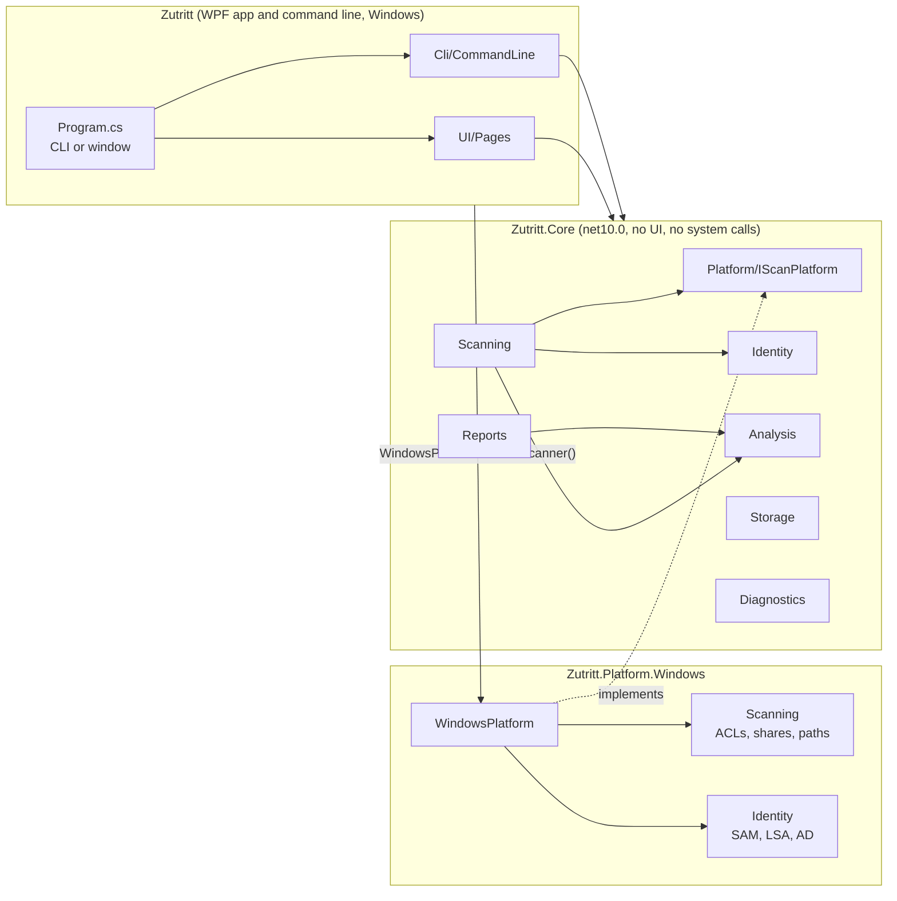

<sub><a href="../README.md">Zutritt</a> › <a href="../README.md#documentation">Documentation</a> › Development</sub>

# Development

Building, testing and releasing Zutritt, how the code is organised, and how the images in this documentation are made.

**Contents:** [Requirements](#requirements) · [Build](#build) · [Tests](#tests) · [Architecture](#architecture) · [Database schema](#database-schema) · [MSI](#msi) · [CI and releases](#ci-and-releases) · [Releasing a version](#releasing-a-version) · [Dependencies and licences](#dependencies-and-licences) · [Screenshots and images](#screenshots-and-images) · [Hidden switches](#hidden-switches)

> [!NOTE]
> Comments in source code, tests and CI cite the internal ICT Baden guidelines (`Richtlinie NN`, `interne Richtlinie NN`); they are not public. Everything needed to build, test and contribute is in [CONTRIBUTING.md](../CONTRIBUTING.md) and in this folder.

## Requirements

- **.NET 10 SDK.** `global.json` pins `10.0.100` with `rollForward: latestFeature`, so newer 10.0 feature bands work too.
- **Windows** for the app, the Windows-specific code and the full test suite. **Linux or macOS** are enough for the platform-neutral core and its tests (`dotnet test tests/Zutritt.Tests -f net10.0`); the CI runs them on Ubuntu. The projects set `EnableWindowsTargeting`, so the Windows projects also restore there.
- **Administrator rights** for the full test suite on Windows (see [Tests](#tests)).
- For the MSI: nothing extra – the WiX Toolset comes as an MSBuild SDK (`WixToolset.Sdk` 5.0.2) via NuGet.

## Build

```powershell
dotnet build Zutritt.sln
dotnet run --project src/Zutritt -- --demo          # window with demo data
dotnet run --project src/Zutritt -- --hilfe         # command-line help
dotnet run --project src/Zutritt -- --info          # version, build, licence, links
```

Release builds as the CI produces them:

```powershell
$common = 'src/Zutritt/Zutritt.csproj', '-c', 'Release', '-r', 'win-x64', '-p:PublishSingleFile=true', '-p:DebugType=none'
dotnet publish @common --self-contained false -o out/framework       # needs the .NET 10 Desktop Runtime
dotnet publish @common --self-contained true  -o out/self-contained  # basis of the MSI
dotnet publish @common --self-contained true -p:IncludeNativeLibrariesForSelfExtract=true `
               -p:EnableCompressionInSingleFile=true -o out/standalone  # the single Zutritt.exe
```

The version comes from `<Version>` in `src/Zutritt/Zutritt.csproj`; `Zutritt.Core` and `Zutritt.Platform.Windows` read it from there, and the CI overrides it for all projects with `-p:Version=…`. The build appends the commit (`0.1.0-ci.12+abc1234…`); the *Info* page and `--version` show it as *Build abc1234*.

Settings shared by all projects – language version, nullable, implicit usings, `Company`, `Product`, `Copyright`, the neutral language `en` and the satellite languages `en;de;es;fr;zh-Hans` – live in [`Directory.Build.props`](../Directory.Build.props). The company name is set there once and appears in every assembly, on the *Info* page and in `--info`. The publish output contains `LICENSE` and `THIRD-PARTY-NOTICES.txt`; both are also embedded in `Zutritt.exe` for the *Info* page and `--lizenzen`.

## Tests

```powershell
dotnet test Zutritt.sln                          # Windows, in an elevated terminal for the full suite
dotnet test tests/Zutritt.Tests -f net10.0       # only the platform-neutral part – also on Linux and macOS
```

The xUnit project `tests/Zutritt.Tests` targets two frameworks:

| Target | Runs on | Contains |
|---|---|---|
| `net10.0-windows` | Windows | everything – about 1,260 tests |
| `net10.0` | any system | the platform-neutral tests – about 950: rules, effective access, comparison, identity resolution against fakes, storage, Excel and PDF, logging, time limits, the scanner against a fake platform |

Everything under `tests/Zutritt.Tests/Windows/` is compiled for the Windows target only: ACL reading, shares, local accounts, the app (*Info* data, command line, demo data, third-party notices). Many of these are **integration tests against the real Windows**: they create temporary folders with real ACLs, real SMB shares and real local users and groups, scan them and clean up afterwards. They are marked `[AdminFact]` and are **skipped without administrator rights** – run the suite elevated before you trust a green result. The CI runner runs as administrator. Other markers:

- `[WindowsFact]` – Windows behaviour that other systems lack (e.g. mandatory file locks); skipped elsewhere.
- `[PdfFact]` – needs a font for the PDF report (Segoe UI, Arial, DejaVu Sans, Liberation Sans …); skipped without one. The CI installs `fonts-dejavu-core` and `fonts-liberation` on Linux.
- `[PdfLayoutFact]` – checks that texts fit their columns; the widths are tuned to Segoe UI, so these run on Windows only.

Notable test groups:

| Tests | Check |
|---|---|
| `Windows/Analysis/WindowsAccessCheckTests` | The computed effective rights match the Windows access check (AuthZ, `MAXIMUM_ALLOWED`) bit for bit, for a real local account in a real local group. |
| `Windows/Scanning/*` | ACL reading, NT4-style ACLs, inheritance expectation (ZT14), shares and share security, long paths, privileges (the tests remove or enable the backup privilege in a copied token, because an enabled one would bypass the ACLs under test). |
| `Scanning/FakePlatformTests` | The scanner on any system, against a fake `IScanPlatform` – including sources that never answer. |
| `Analysis/*` | Rules on synthetic runs and on system folders (`FindingRulesSystemTests`), effective access, people access, comparison – including equivalence with the straightforward calculation and a time budget for large comparisons. |
| `Identity/*` | SID resolution against a fake directory, SID text conversion, time limits, well-known SIDs. Active Directory can only be tested for the case “no domain controller reachable” – there is no domain on the development machine. |
| `Storage/*`, `Reports/*` | Round trips through SQLite, large runs, Excel and PDF content and layout. |
| `Windows/App/*` | `--version`, `--info` and `--lizenzen` (run as a real process), the *Info* data, demo data without person names, and that every package in `Zutritt.deps.json` is listed in `THIRD-PARTY-NOTICES.txt`. |

## Architecture

Zutritt is bound to Windows by its task: NTFS permissions, SMB share permissions, the local account databases (SAM, LSA) and Active Directory exist only there. That is why the app is a WPF program (the exception the ICT Baden guidelines make for Windows-bound tools). Everything that does not need Windows lives in a platform-neutral core, so it can be tested on Linux and reused by another front end if one is ever needed.



| Project / folder | Content |
|---|---|
| `src/Zutritt.Core` | Targets `net10.0`; CA1416 (Windows-only API) is an error, so nothing Windows-specific can slip in. |
| `…/Model` | Data model: `ScanRequest`, `ScanResult`, `FolderNode`, `AceEntry`, `ShareInfo`, `ShareAce`, `Principal`, `Finding`, `AccessLevel`/`ShareAccess`, `Rights`, the own `FileRights`/`AceInheritance`/`AcePropagation` (same numeric values as Windows, so stored runs stay readable) and `WindowsPath` (scanned paths are Windows paths on every system) |
| `…/Platform` | `IScanPlatform` – the one interface to the system: parse targets, probe paths, read ACLs, list folders, list and look up shares, current user, identity resolver. `TimeBudget` – time limits for calls that can hang |
| `…/Scanning` | `Scanner` (one run; without a platform it reports *Scannen ist nur unter Windows möglich*), `ScanRun` (targets, shares, tree walk), `ShareSecurity`, `NodeSignature` (what gets stored), `InheritanceExpectation` (ZT14), `LocalShareMap` |
| `…/Identity` | `IdentityResolver` and `ResolveSession` (order of sources, orphaned vs. unknown, group expansion, time limits), `IDirectory`, `SidText` (SID parsing and formatting without Windows), `WellKnownSids` (fixed names in the language of the interface), `FakeDirectory` for tests |
| `…/Analysis` | `FindingRules` (all rule texts and conditions), `AccessContext` (tokens, stored ACE order and canonical check, share levels), `EffectiveAccess`, `PeopleAccess` (all people at once), `ScanComparer`, `SidCatalog` |
| `…/Storage` | `ScanStore`, `Schema` (migrations), `ScanWriter`/`ScanReader`, `TargetSet` (which runs are comparable), `DatabaseLocation` (`%LocalAppData%\Zutritt`; on Linux `~/.local/share/zutritt`) |
| `…/Reports` | `ReportDataBuilder` (shared by both formats), `ExcelReport` (ClosedXML), `PdfReport` (PDFsharp-MigraDoc), `PdfFonts` (system fonts, with Linux and macOS fallbacks), `ReportFile` (safe writing) |
| `…/Diagnostics` | `Log` (daily log, 7 days, 1 MB per day, no permissions or account names), `DiagnosticsPackage` and `Anonymizer` (ZIP for support) |
| `src/Zutritt.Platform.Windows` | `WindowsPlatform` (implements `IScanPlatform`), `Scanning/` (`AclReader` with `NtOpenFile` and `READ_CONTROL`, `DirectoryLister`, `LongPath`, `ShareEnumerator` and `ShareDescriptor` for `NetShareEnum`/`NetShareGetInfo`, `TargetParser`), `Identity/` (`LocalDirectory` for SAM, `WindowsAccountLookup` for LSA, `ActiveDirectoryDirectory`, `ComputerDomain`) |
| `src/Zutritt` | `Program.cs` (entry point: command line without WPF, or the window), `Cli/` (`CommandLine`, `ConsoleSession` for console attachment and encodings), `UI/` (pages, folder tree, Fluent theme shared in style with the sibling app Vitrine, `Links` – opens only http/https), `AppInfo` and `LicenseTexts` (*Info* page, `--info`), `AppDiagnostics` (log start, unhandled exceptions, diagnostics package), `Demo/` (demo and large synthetic runs) |
| `installer/` | WiX 5 MSI |
| `tests/Zutritt.Tests` | xUnit tests, see [Tests](#tests) |
| `tools/screenshots` | Generator for the documentation images |

NuGet dependencies: the core uses `Microsoft.Data.Sqlite`, `ClosedXML` and `PDFsharp-MigraDoc` (plus `System.Security.Cryptography.Pkcs` pinned to a maintained version, because PDFsharp pulls in one with known vulnerabilities); the Windows project adds `System.DirectoryServices.AccountManagement`. Code comments and some identifiers are in German. **User-facing text** lives in `src/Zutritt.Core/Resources/Strings.resx` (English, the fallback) and `Strings.de.resx`, `Strings.es.resx`, `Strings.fr.resx`, `Strings.zh-Hans.resx`; the class `Zutritt.Core.Resources.Strings` is generated by the build. In code use `Strings.Key`, with placeholders `Texts.Format(Strings.Key, …)` (never concatenate sentences), quotes and lists with `Texts.Quote` and `Texts.JoinAnd`, singular/plural with `Texts.Plural`; in XAML `{x:Static res:Strings.Key}`. Every new text goes into all five files – `LocalizationTests` checks keys, placeholders and that every text can be formatted. Errors shown to the user carry a code from `ErrorCodes` (list in [Error codes](error-codes.md)). The tests run in German (`TestCulture`).

## Database schema

The SQLite schema is versioned in `PRAGMA user_version` (currently 2) and identified by `PRAGMA application_id` = `ZTRT`. Each entry in `Schema.Migrations` raises the version by exactly one; existing steps are never changed, so older files stay readable. Version 2 added `folder.inheritance_differs` for ZT14. New local databases use WAL; on network paths the classic journal is used (see [Data & privacy](data-and-privacy.md#where-it-is-stored)).

## MSI

```powershell
dotnet publish src/Zutritt/Zutritt.csproj -c Release -r win-x64 -p:PublishSingleFile=true --self-contained true -o publish
dotnet build installer/Zutritt.Installer.wixproj -c Release -p:ProductVersion=0.1.0
```

`installer/Package.wxs` installs everything from the publish folder (without `.pdb`, with `LICENSE` and `THIRD-PARTY-NOTICES.txt`) per machine into `C:\Program Files\Zutritt`, adds a Start menu shortcut, closes a running Zutritt (a scan stopped this way ends with exit code 3, like Ctrl+C), links *Apps & features* to `SUPPORT.md`, and sets `MajorUpgrade` with `AllowSameVersionUpgrades` so that CI builds – which differ only in the fourth version part – replace each other. **Never change the `UpgradeCode` or the GUID of the Start menu component** – an update would then install next to the old version instead of replacing it. The UI culture of the package is `de-DE`; `Manufacturer` is *ICT Baden GmbH*. ICE38, 43, 57, 60 and 61 are suppressed with reasons in the project file; all other ICE checks also run on CI.

## CI and releases

`.github/workflows/build.yml` runs for pushes to `main`, tags `v*`, pull requests, nightly and manual starts; changes to documentation only (`**.md`, `docs/**`, `LICENSE`, issue templates) start nothing. A first job **`gate`** decides how much a run builds (internal guideline 04, *Wann die CI baut*), because Windows minutes cost twice as much:

- **Push to `main`, push to a pull request:** only `linux`.
- **Full build** (`linux`, then `windows`): nightly when `main` has changed more than documentation since the last full build (the tag `latest`), tags `v*`, manual starts (`gh workflow run build.yml --ref main`), a push whose last commit message contains `[voll]`, and pull requests with the label `voll-bauen` or with changes that Linux does not build or test (`FULL_PATHS` in the workflow: `.github/`, `installer/`, the WPF app, `Zutritt.Platform.Windows`, the Windows tests, build settings, tools). On `main` a full build updates `latest`.

The jobs:

1. **`linux`** (ubuntu-latest): checks the **syntax of every PowerShell step** of the workflows and of every `.ps1` script ([`ps-syntax.py`](../.github/scripts/ps-syntax.py), [`ps-syntax.ps1`](../.github/scripts/ps-syntax.ps1)) – including the steps that only run for tags or on `main`, and treating typographic quotes that delimit a string as an error. It writes the release notes of the csproj version once if the changelog already has its section. Then it installs DejaVu and Liberation fonts, builds and runs `tests/Zutritt.Tests -f net10.0` – the platform-neutral part.
2. **`windows`** (windows-latest), once `linux` is green:
   1. **Version:** a tag `v1.2.3` gives `1.2.3`; otherwise the csproj version plus the run number, e.g. `0.1.0-ci.12`. The MSI gets `0.1.0.12` (numbers only; for a tag `1.2.3`). The **file version** of the exe and the DLLs always ends in the run number, for a tag too (`1.2.3.57`): with `x.y.z.0` the release was older than a CI build of the same version, and Windows Installer did not copy `Zutritt.exe` when updating from `latest`. The step prints whether signing is active. For a tag, the **release notes** are written right away with [`.github/scripts/release-notes.ps1`](../.github/scripts/release-notes.ps1) – the part *English* of the version's section in `CHANGELOG.md` plus the list of files – so that a missing section stops the run before the build.
   2. **Restore, build, test** (Release, both test targets one after the other, as administrator).
   3. **Publish** the three variants and **check the output**: neither the Windows SDK projection nor the unused PDFsharp extras (`PdfSharp.WPFonts`, `.Snippets`, `.Quality`) may appear, and the language files must be exactly `de`, `es`, `fr`, `zh-Hans` (English is built in).
   4. **Sign** the three `Zutritt.exe` – only when the organisation variable `SIGNING_ACCOUNT` is set, and never for pull requests. Signing uses Azure Artifact Signing with OIDC: secrets `AZURE_CLIENT_ID`, `AZURE_TENANT_ID`, `AZURE_SUBSCRIPTION_ID`, variables `SIGNING_ENDPOINT`, `SIGNING_ACCOUNT`, `SIGNING_PROFILE`. Without them the steps are skipped and the build stays green, unsigned.
   5. **Package** the ZIP (with `README.md`, `LICENSE`, `THIRD-PARTY-NOTICES.txt` – the step fails if the licence files are missing) and the single exe; **build the MSI** from the self-contained output and sign it (same condition). Then the **MSI probe** installs it silently on the runner (`msiexec /qn`), checks the installation folder and the Start menu entry, runs `Zutritt.exe --info` (English and German) and a small scan with an Excel report, uninstalls it and fails if anything is left behind. Then [`msi-update-test.ps1`](../.github/scripts/msi-update-test.ps1) installs the new MSI over the build of `latest`, over the last tagged release and over a package of the same version whose exe has a higher file version (built only for this test); after each update every file of the publish folder must be there, `Zutritt.exe` must have the new file version and `--version` must name the new version. The `msiexec` logs are uploaded only when a step fails.
   6. **SBOM** with CycloneDX (`dotnet tool restore`, version pinned in `.config/dotnet-tools.json`), trimmed by [`.github/scripts/sbom-shipped.ps1`](../.github/scripts/sbom-shipped.ps1) to what the packages really contain: packages that NuGet prunes because the .NET or Windows Desktop runtime provides them are removed, the runtime packs are added with their real versions, and a shipped package missing from the SBOM fails the build. Then **`SHA256SUMS.txt`** over all files (LF line endings, so `sha256sum -c` works on Linux too).
   7. **Build provenance** (`actions/attest-build-provenance`) – only while the repository is public.
   8. **Artifact** with all files, kept 7 days (the maximum the repository allows), for trying out a pull request. Uploads may fail (the artifact storage is shared by all repositories of the organisation) without failing the build; the releases take the files directly from `dist/`.
   9. **Release:** a tag `v*` creates the release *Zutritt v…* with these notes and versioned file names (except `Zutritt.exe`, which keeps its name for scheduled tasks and scripts, and `SHA256SUMS.txt`); for a pre-release without its own section the notes are a short pre-release note; a tag with a hyphen (`v1.2.0-rc1`) becomes a pre-release. A full build of `main` (see above) updates the release **`latest`** in place with [`.github/scripts/release-latest.ps1`](../.github/scripts/release-latest.ps1): new files are uploaded under temporary names first, then replace the old ones under the fixed names `Zutritt-x64.msi`, `Zutritt.exe`, `Zutritt-win-x64-framework.zip`, `Zutritt-sbom.cdx.json` and `SHA256SUMS.txt`, so the download links never break. `latest` is marked *Latest* as long as there is no tagged release; after the first tag it becomes a pre-release.

Runs on the same branch are queued, so `latest` updates do not overtake each other; in a pull request a new push cancels the previous run. Dependabot ([`.github/dependabot.yml`](../.github/dependabot.yml)) proposes NuGet, GitHub Actions and npm updates, except the ones that would change a licence (see below).

## Releasing a version

1. In [`CHANGELOG.md`](../CHANGELOG.md), rename *Unveröffentlicht* to `## [X.Y.Z] – YYYY-MM-DD` and start a new empty *Unveröffentlicht* above it. End the section with `### English` – the release notes in English (the changelog itself is German). The test `ChangelogTests` fails without it.
2. Raise `<Version>` in `src/Zutritt/Zutritt.csproj` to `X.Y.Z` and merge to `main`.
3. Tag and push: `git tag vX.Y.Z && git push origin vX.Y.Z`.
4. The CI builds, signs (when configured), writes the SBOM and the checksums and creates the release.
5. Raise `<Version>` on `main` to the next patch version (`X.Y.Z+1`), so that builds of `main` are never named older than the release. `ChangelogTests` checks that the csproj is never behind the newest version in the changelog.
6. Install the MSI on a clean machine, start the app and the demo, and check *Info* (version, build, licence).

The release checklist of the guidelines lists the remaining checks (README, screenshots, notices).

## Dependencies and licences

Zutritt is MIT-licensed ([`LICENSE`](../LICENSE)). Everything it ships from others is listed with version, source, copyright and licence text in [`THIRD-PARTY-NOTICES.txt`](../THIRD-PARTY-NOTICES.txt) – the NuGet packages, the parts bundled inside them, the .NET/WPF runtime in the self-contained variants and the WiX custom action in the MSI.

- **Every new or updated package goes into `THIRD-PARTY-NOTICES.txt`** in the same change. The test `ThirdPartyNoticesTests` compares the notices with `Zutritt.deps.json` and fails for a package that is missing.
- **Versions that stay where they are**, because newer ones change the licence: PDFsharp/MigraDoc **6.2.x** (MIT; 6.5.0 and later are AGPL-3.0), SixLabors.Fonts **1.x** via ClosedXML (Apache-2.0; 2.0 and later Six Labors Split License), WiX **5.x** (MS-RL; 6.0 and later the OSMF EULA). Dependabot ignores these jumps.
- The release contains a CycloneDX SBOM of the shipped packages and runtime packs (from the `deps.json` of the publish, like the THIRD-PARTY-NOTICES test).

## Screenshots and images

All images under `docs/assets` are generated from the real app, never redrawn:

```powershell
cd tools\screenshots
pip install pypdfium2 pillow   # PDF pages; permissive licences (not PyMuPDF, which is AGPL)
npm install                    # playwright-core, for the banner
.\make-assets.ps1
```

The script

1. builds Zutritt (Release) and runs `Zutritt.exe --screenshots <temp>`: every page of the demo, light and dark, at 1200 × 800 and 1.5× scale, in a window placed off-screen, with dates and numbers in the format of the language (`ZUTRITT_LANGUAGE=de` → German) and the *Info* page as it looks when no language has been chosen (*Wie Windows (Deutsch)*). The German page names are mapped to the English file names used here (`uebersicht` → `overview`, `ordner-verschoben` → `folders-moved` …);
2. writes a demo PDF with `--demo-bericht --vergleich` and renders the cover, summary, changes and sign-off pages with `report-pages.py` (pypdfium2 and Pillow);
3. renders `banner.html` to `banner.png` (2560 × 840) with the installed Google Chrome through playwright-core (`CHROME_PATH` for another browser). The banner background uses the icon colours `#22C3A6` → `#3B6CF6`; `docs/assets/logo.svg` is the source of the icon.

It needs a **signed-in, connected Windows session** – no visible window, but WPF draws nothing in a disconnected session (Remote Desktop closed without signing out). `--screenshots` then stops with exit code 3 instead of writing empty images. The screenshots show only the demo data – role accounts like *MUSTER\qc.leitung*, no names of people.

## Hidden switches

Not listed in `--hilfe`, meant for development and documentation:

```text
Zutritt.exe --demo-bericht --bericht <datei> [--bericht …] [--vergleich]
Zutritt.exe --messen [<ordner>] [--ordner N] [--personen N]
```

- `--demo-bericht` – Writes Excel or PDF reports from the built-in demo runs. Like `--screenshots`, it formats dates and numbers in the language of the output, not in the regional format of the PC – German images get German dates on an English Windows too.
- `--messen` – Benchmark: creates a large synthetic run (default 50,000 stored folders and 3,000 people), opens it like the app, and prints per step the duration and the longest time the UI thread was blocked. With a folder, it also saves an image of every page. The environment variable `ZUTRITT_MESSEN_SEITEN=befunde,ordner` limits the measurement to those pages; add `berichte` to include the reports.

---

<p align="center"><sub>
<a href="installation.md">Installation</a> · <a href="usage.md">Using the app</a> · <a href="command-line.md">Command line</a> · <a href="rules.md">Rules</a> · <a href="how-it-works.md">How it works</a> · <a href="excel-and-pdf.md">Excel &amp; PDF</a> · <a href="data-and-privacy.md">Data &amp; privacy</a> · <a href="limitations.md">Limitations</a> · <b>Development</b><br>
<a href="../README.md">← Back to Zutritt</a>
</sub></p>
