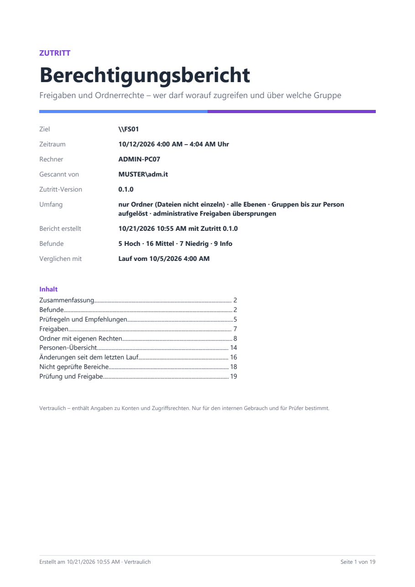
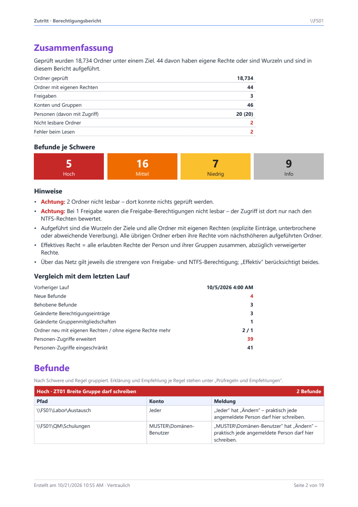
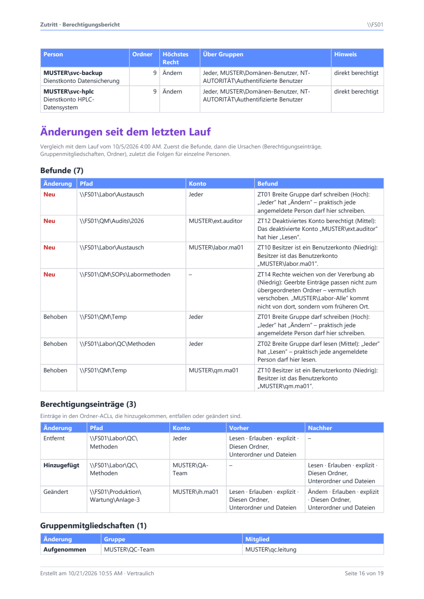
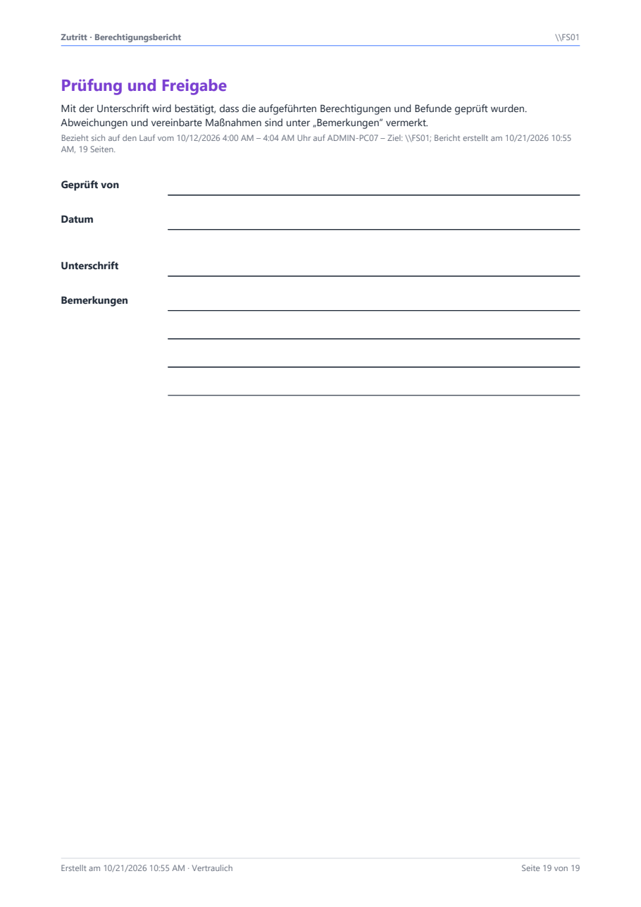

<a href="../README.md">Zutritt</a> › <a href="../README.md#documentation">Documentation</a> › Reports: Excel &amp; PDF

# Reports: Excel & PDF

Two formats from the same data: an **Excel workbook** to filter and work with, and a **PDF** to file and sign. Both are in the language of the interface (German here – the title is *Berechtigungsbericht*, permissions report); numbers and dates follow the regional format of Windows.

**Contents:** [Creating one](#creating-one) · [What both contain](#what-both-contain) · [Excel workbook](#excel-workbook) · [PDF](#pdf) · [Sign-off](#sign-off) · [Size limits and truncation](#size-limits-and-truncation) · [Writing the file](#writing-the-file)

## Creating one

| Where | How |
|---|---|
| App | *Bericht* page › *Excel-Bericht speichern …* or *PDF-Bericht speichern …*; *Änderungen seit dem letzten Lauf aufnehmen* includes the comparison selected on *Vergleich* |
| Command line, while scanning | `scan … --bericht <datei>`, several times for several files, with `--vergleich` for the comparison |
| Command line, later | `bericht <id> --bericht <datei> [--vergleich]` – any saved run, see [`liste`](command-line.md#liste) |

Each file always describes **one stored run**. The findings are taken from the run as they were evaluated at scan time; effective rights and texts come from the same analysis the app uses, so file and app show the same numbers.

## What both contain

- **The run:** targets, period, PC, who scanned (*Gescannt von*), the Zutritt version of the scan and of the export.
- **The scope** (*Umfang*), in one line – e.g. *nur Ordner (Dateien nicht einzeln) · alle Ebenen · Gruppen bis zur Person aufgelöst · administrative Freigaben übersprungen*. An auditor sees what was and was not checked.
- **Notes** (*Hinweise*), warnings first (*Achtung*): unreadable folders, read errors, shares whose permissions were not readable, a depth limit, a run without group resolution, groups whose members could not be read, and any truncation of this file. Then reading aids: which folders are listed, what *effektiv* means, and that over the network the stricter of share and NTFS permission applies.
- **Names** for every SID, taken from the run – for deleted accounts from the older run of a comparison, for well-known SIDs the fixed name in the language of the interface, otherwise the SID itself. A cell is never empty where an account is meant.

## Excel workbook

Every sheet except the overview is an Excel table with **autofilter and a frozen header row**, set up to print on A4 landscape, one page wide, with *Seite X von Y* in the footer.

| Sheet | One row per | Columns |
|---|---|---|
| *Übersicht* | – | run, numbers, findings per severity, comparison, notes, and a guide to the other sheets |
| *Befunde* | finding | *Schwere*, *Regel*, *Titel*, *Pfad*, *Konto*, *Meldung*, *Empfehlung*, *SID* |
| *Ordner & Rechte* | ACE of each listed folder (also inherited ones) | *Pfad*, *Tiefe*, *Typ*, *Vererbung unterbrochen*, *Vererbung weicht ab*, *Besitzer*, *Konto*, *Art*, *Recht*, *Erlauben/Verweigern*, *Geerbt/explizit*, *Gilt für*, *Freigabe*, *Hinweis*, *SID*, *Rechte-Maske* |
| *Personen* | user account | *Person*, *Anzeigename*, *Deaktiviert*, *Ordner mit Zugriff*, *Höchstes Recht*, *Über Gruppen*, *Direkt berechtigt*, *SID* |
| *Zugriffe je Person* | person × folder with access | *Person*, *Anzeigename*, *Pfad*, *Effektives Recht*, *NTFS-Recht*, *Über Freigabe*, *Über Gruppen*, *Durch Verweigern eingeschränkt* |
| *Gruppen* | group | *Gruppe*, *Mitglieder direkt*, *Mitglieder gesamt (Personen)*, *Vollständig*, *In Ordner-ACLs*, *Direkte Mitglieder*, *Hinweis*, *SID* |
| *Freigaben* | share | *Freigabe*, *Pfad*, *Bemerkung*, *Freigabe-Rechte*, *Admin-Freigabe*, *Rechte lesbar* |
| *Prüfregeln* | rule | *Regel*, *Schwere*, *Titel*, *Erklärung*, *Empfehlung*, *Befunde* – the scope of the review, including rules without findings |
| *Änderungen* | change (only with a comparison) | *Bereich*, *Änderung*, *Pfad bzw. Gruppe*, *Konto*, *Vorher*, *Nachher* |
| *Fehler* | path that could not be read | *Pfad*, *Meldung* |

Details that help when filtering:

- *Gilt für* uses the wording of the Windows dialog *Erweiterte Sicherheitseinstellungen* – *Nur diesen Ordner*, *Diesen Ordner, Unterordner und Dateien*, *Nur Dateien* …, with *(nur eine Ebene)* for “this level only”. *Rechte-Maske* gives the raw mask, e.g. `0x001301BF`.
- *Über Gruppen* shows the chain from the person to the entry, e.g. *QC-Team → Labor-Alle*, or *direkt*. *Über Freigabe* is *–* when the folder is not reached through a share or the share permissions could not be read.
- On *Gruppen*, *Mitglieder gesamt (Personen)* counts people through nested groups; *Vollständig = Nein* and the *Hinweis* say when members could not be read, or when the group contains *Jeder* or *Authentifizierte Benutzer* and thus practically all users.
- On *Änderungen*, the areas (*Bereich*) are *Befund*, *Berechtigung* (ACL entry), *Mitgliedschaft*, *Ordner* and *Zugriff* (access of a person: *Mehr Zugriff* / *Weniger Zugriff*). If an entry changed only in detail, *Vorher* and *Nachher* show the mask as well.

## PDF

A4 portrait, set in Segoe UI (falling back to Arial, Tahoma or Verdana), with a running header *Zutritt · Berechtigungsbericht* plus the target, and a footer *Erstellt am … · Vertraulich* and *Seite X von Y*.

**Fonts.** Zutritt ships no fonts. The PDF uses the font installed on the computer that creates the report (Segoe UI and Arial come with Windows; on Linux and macOS DejaVu Sans or Liberation Sans) and embeds only the subset of characters the report actually uses, so it looks the same on every computer – as with any PDF created on Windows. For Chinese text a Chinese font from that computer is embedded the same way.

The sections:

| Section | Content |
|---|---|
| Cover | Target(s), period, PC, scanned by, version, scope, findings per severity, the run compared with, a table of contents with page numbers, and the note *Vertraulich – enthält Angaben zu Konten und Zugriffsrechten* (confidential) |
| *Zusammenfassung* | Numbers, findings per severity as coloured tiles, notes, and the comparison in figures |
| *Befunde* | Grouped by severity and rule; each group has a coloured bar with rule and title, then *Pfad*, *Konto*, *Meldung* |
| *Prüfregeln und Empfehlungen* | All 15 rules with severity, number of findings, explanation and recommendation – also those without findings |
| *Freigaben* | Each share with path, remark and share permissions; deny entries in red |
| *Ordner mit eigenen Rechten* | Each listed folder with depth, inheritance state, owner and share; a table of its explicit entries (*Konto*, *Art*, *Recht*, *Typ*, *Gilt für*) and one line with the inherited ones |
| *Personen-Übersicht* | People with access: number of folders, highest right, groups, and hints such as *deaktiviert* or *direkt berechtigt* |
| *Änderungen seit dem letzten Lauf* | Only with a comparison: findings, then the causes (ACL entries, group memberships, folders), then the consequences for people – grouped per folder, *Mehr Zugriff* first |
| *Nicht geprüfte Bereiche* | Paths that could not be read – the document makes no statement about them |
| *Prüfung und Freigabe* | The sign-off block |

<table>
  <tr>
    <td width="50%" valign="top"> <b>Cover</b> with run details and table of contents</td>
    <td width="50%" valign="top"> <b>Summary</b> with severity tiles, notes and comparison</td>
  </tr>
  <tr>
    <td valign="top"> <b>Changes</b> since the previous run</td>
    <td valign="top"> <b>Sign-off</b> block on the last page</td>
  </tr>
</table>

Pages of a PDF made from the built-in demo data, with comparison.

## Sign-off

The last section, *Prüfung und Freigabe* (review and approval), turns the PDF into evidence of a periodic access review:

- the statement *Mit der Unterschrift wird bestätigt, dass die aufgeführten Berechtigungen und Befunde geprüft wurden. Abweichungen und vereinbarte Maßnahmen sind unter „Bemerkungen“ vermerkt.* – by signing, the reviewer confirms that the listed permissions and findings were reviewed; deviations and agreed actions are noted under remarks;
- a reference line with the run's period, PC, targets, creation time and the total number of pages, so that a signed page filed separately can still be traced to its document;
- lines for ***Geprüft von*** (reviewed by), ***Datum***, ***Unterschrift*** (signature) and ***Bemerkungen*** (remarks), kept together on one page.

Print and sign it, or sign the PDF electronically. Use *Bemerkungen* to record which findings are deliberately left as they are, and why.

> [!NOTE]
> The PDF documents a review; it is not a qualified or validated record in itself. How it fits into your GMP, ISO/IEC 27001 or NIS2 processes is up to you.

## Size limits and truncation

Large runs are stored completely in the database, but not every list fits into a file. Whenever something is cut, the file says so – in the notes of the overview or summary and right where the list ends.

| Limit | Value | What happens |
|---|---|---|
| Excel rows per sheet | 500,000 | The sheet is cut; the overview names the sheet and how many rows are shown |
| Excel cell text | 32,767 characters | Cut with `…` – the limit of Excel |
| Individual accesses (person × folder), all people together | 200,000 | Only **whole** people are listed on *Zugriffe je Person*; for the others the totals on *Personen* are complete, and a column *Einzelzugriffe aufgeführt* says *Nein – nur die Summe* |
| PDF: findings | 1,000 | *Gekürzt: 1.000 von … gezeigt – vollständig im Excel-Bericht* |
| PDF: folders with own permissions | 250 | as above |
| PDF: people with access | 1,000 | as above |
| PDF: changes | 1,000 per area | access changes of people are grouped per folder: 1,000 folders |
| PDF: names per folder in access changes | 15 | *… und N weitere* |
| PDF: share permissions per share | 20 | *… und N weitere Einträge* |
| PDF: unreadable paths | 250 | as above |
| PDF cover: targets | 5 | *… und N weitere* |

The PDF is meant to be read and signed; the Excel workbook is the complete record.

## Writing the file

The file is first written to a temporary file in the target folder and then moved into place. If writing fails, no half-written file remains, and an existing file – one still open in Excel, say – is not destroyed. If the file is open in another program, Zutritt says so: *Die Datei … ist in einem anderen Programm geöffnet (z. B. Excel oder einem PDF-Betrachter).* The target path is checked before any work starts; only `.xlsx` and `.pdf` are accepted.

Treat these files as confidential: they contain a map of who can access what. See [Data & privacy](data-and-privacy.md#exported-files).

---

<a href="installation.md">Installation</a> · <a href="usage.md">Using the app</a> · <a href="command-line.md">Command line</a> · <a href="rules.md">Rules</a> · <a href="how-it-works.md">How it works</a> · <b>Excel &amp; PDF</b> · <a href="data-and-privacy.md">Data &amp; privacy</a> · <a href="limitations.md">Limitations</a> · <a href="development.md">Development</a> 
<a href="../README.md">← Back to Zutritt</a>

