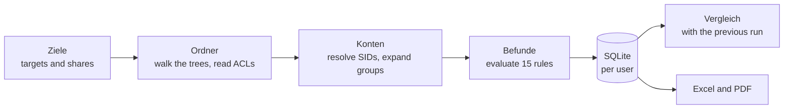
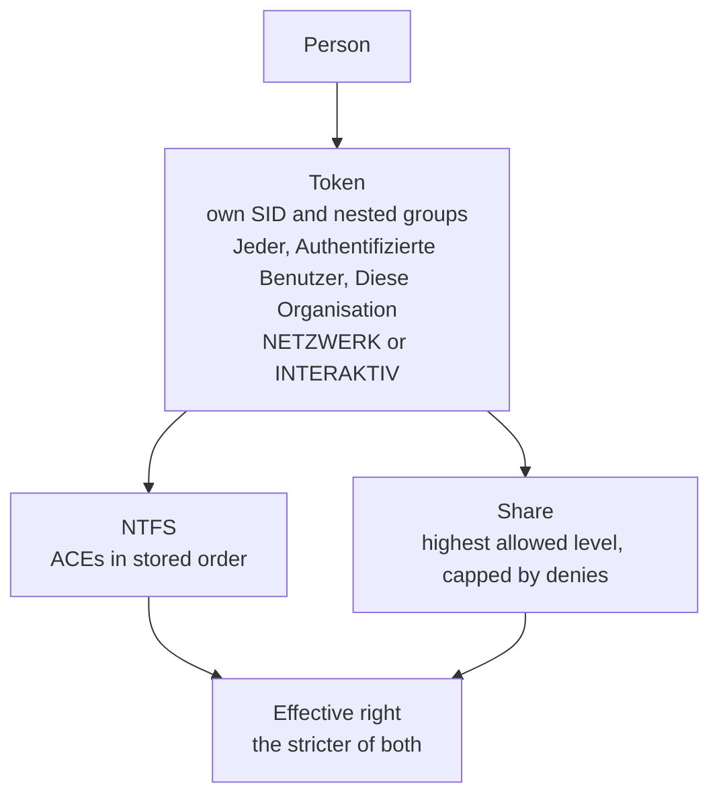

<a href="../README.md">Zutritt</a> › <a href="../README.md#documentation">Documentation</a> › How it works

# How it works

What happens between *Scan starten* and the report: how Zutritt reads shares and ACLs, what it keeps, how it turns SIDs into people and how it computes who can access what.

**Contents:** [The run](#the-run) · [Targets and shares](#targets-and-shares) · [Walking the tree](#walking-the-tree) · [What gets stored](#what-gets-stored) · [Inheritance check](#inheritance-check) · [Identities](#identities) · [Rights levels](#rights-levels) · [Effective access](#effective-access) · [Comparison](#comparison)

## The run

A run passes through the phases shown in the progress display – *Ziele*, *Ordner*, *Konten*, *Befunde* – and is then saved:

Everything is read-only. Expected problems – a server that does not answer, a folder that denies access, an invalid target – do not abort the run; they are recorded and become [ZT09](rules.md#zt09--folder-not-readable) or [ZT13](rules.md#zt13--share-permissions-not-readable) findings.

## Targets and shares

| Target | Resolved to |
|---|---|
| `\\server\share[\path]` | that share (its details are looked up) and the path as root |
| `\\server` | all disk shares of the server, each as a root |
| `D:\Data` | the local folder as root |
| `.` | all disk shares of this PC, each as a root through its **local** path |

Administrative and hidden shares (`C$`, `ADMIN$`, names ending in `$`) are skipped unless requested. Duplicate targets are scanned once; a target inside another one is scanned only as its own root.

**Share list and details.** The list of shares comes from `NetShareEnum` level 1, which works without administrator rights. Path and permissions of each share come from `NetShareGetInfo` level 502, which needs administrator rights on the server. Without them, the share stays in the run, marked *Freigabe-Berechtigungen nicht lesbar* (ZT13), and network access is rated by NTFS alone.

**DFS.** If `\\server\share` is a DFS namespace, the folders in it do not all live on that share: every DFS link points to a share on some server, and Windows checks **that** share's permissions on access. Zutritt therefore asks the DFS client of this PC (`NetDfsGetClientInfo`, after touching the path so that the referral is cached) for the target of the namespace root and of each link – for the target itself, for the links on the way to it, and for every folder inside the namespace root while walking. Folders behind a link are assigned to the target share (`\\FS01\Lab`), keep their DFS path, and local groups are read from the target server. With several targets, the one this PC is using counts.

**Share permissions** are reduced to the three levels of the Windows share dialog – *Lesen*, *Ändern*, *Vollzugriff* (read, change, full control):

- **Allow entries** count with the highest level for which at least one characteristic right is set: changing permissions or ownership → *Vollzugriff*; writing, appending, deleting or writing attributes → *Ändern*; reading or executing → *Lesen*.
- **Deny entries** count from the lowest level they block **completely**, and block that level and everything above. A deny of *Vollzugriff* in the Windows dialog already blocks reading, so it is stored as “denied from *Lesen* up” and shown as *Verweigert: alles (ab Lesen)*; a deny of *Ändern* is *Verweigert: Ändern und Vollzugriff (ab Ändern)* – reading stays possible. Deny entries that block no level completely (e.g. only *delete*) are ignored, because counting them would show less access than exists.
- A share **without a security descriptor** counts as *Jeder: Vollzugriff*, as Windows treats it. Administrative shares without their own descriptor use a default internal to Windows; Zutritt marks them as unreadable instead of guessing.
- Conditional allow entries count; conditional deny entries are ignored. Unknown entry types make the share unreadable rather than silently incomplete.

**Local folders and shares of this PC.** When you scan a local folder, Zutritt also reads the shares of this PC and assigns each folder to the share it is reachable through – the share with the longest matching path wins (`D:\Data\Lab` belongs to a share on `D:\Data\Lab`, not to one on `D:\Data`). If several shares point to the same folder, regular shares win over administrative ones, then the one with the widest access. Such folders are evaluated **as access over that share** (see [effective access](#effective-access)).

## Walking the tree

Each root is walked depth-first, with its entries in alphabetical order so that two runs over the same tree look alike:

- **Permissions** are read with `NtOpenFile` requesting only `READ_CONTROL` – owner and DACL, never file contents – and with backup intent, so that an enabled backup privilege takes effect ([details](installation.md#rights-for-scanning)). Paths are used in the `\\?\` form, so long paths work.
- **Junctions and symbolic links** below a root are recorded with their own ACL but **not followed** – no loops, no tree counted twice. A root that is itself a link is followed, because you named it explicitly. Other reparse points, such as OneDrive placeholders, are ordinary folders.
- **Files** are only examined with *Dateien einbeziehen* / `--dateien`, and only stored when they have permissions of their own.
- **Depth** is counted from the target: the root has depth 0. *Maximale Tiefe* / `--tiefe` stops the walk at that depth.
- **ACL details:** a missing DACL (NULL DACL) means everyone may do everything and is recorded as an explicit *Jeder: Vollzugriff*. Audit and alarm entries are ignored – they grant nothing. Conditional allow entries count as allow; conditional and object-specific deny entries are ignored (“show more access when in doubt”). Entry types Zutritt does not know mark the folder *nicht vollständig auswertbar* (ZT09).

**NT4-style ACLs.** Some ACLs carry no “inherited” markers on disk – created by old copy tools or found under folders like `%TEMP%`. Explorer, `icacls` and `Get-Acl` work out which entries are inherited by comparing with the parent when they display them. Zutritt does the same (`ConvertToAutoInheritPrivateObjectSecurity`); otherwise every such subfolder would look like one with permissions of its own.

## What gets stored

A file server has far more folders than permission exceptions. Zutritt counts every folder (*Ordner geprüft*) but stores only the ones whose permissions cannot be derived from above (*mit eigenen Rechten*):

| Stored | Why |
|---|---|
| every root | starting point of each target |
| folders with explicit entries | their own permissions |
| folders with broken inheritance | inheritance switched off |
| folders that have only inherited entries, but whose effective or passed-on entries still differ from the parent's | e.g. *ERSTELLER-BESITZER* turned into the creator, entries “this folder only” on the parent, moved folders |
| folders whose inherited entries do not match what the parent passes on | moved folders – [ZT14](rules.md#zt14--permissions-differ-from-inheritance) |
| folders with a read error, and the subfolders of such a folder | nothing can be derived from an unreadable parent |
| files with own permissions (only with `--dateien`) | explicit entries, broken inheritance, or other rights than the folder passes on (moved files) |

Every other folder inherits exactly from the nearest stored folder above it. The analysis works on the stored folders and derives the rest when needed – the grey levels in the folder tree, and the subfolders the people view refers to with *Unterordner ohne eigene Rechte erben davon*.

For each stored folder, Zutritt keeps path, depth, owner SID, the flags *Vererbung unterbrochen* and *Vererbung weicht ab*, the share it is reached through, any read error, and every ACE with SID, rights mask, allow/deny, inherited/explicit and inheritance flags. Names are resolved separately, once per SID. See [Data & privacy](data-and-privacy.md#what-is-stored).

## Inheritance check

For [ZT14](rules.md#zt14--permissions-differ-from-inheritance), the scanner computes what each subfolder (and each file) **should** inherit from its parent under the inheritance rules of Windows, and compares that with the inherited entries actually present:

- Subfolders inherit entries marked *container inherit* – effective and, unless marked “this level only”, passed on further – and entries marked only *object inherit* as “inherit only” for their files. Files inherit all entries marked *object inherit*.
- *ERSTELLER-BESITZER* (CREATOR OWNER) becomes the creator, which is normally the owner. If ownership was taken over later, the creator's entry carries another SID; exactly one account with exactly the CREATOR OWNER rights is therefore tolerated. *ERSTELLERGRUPPE* (CREATOR GROUP) is tolerated for one account, because the creator's primary group is not known.
- Generic rights are mapped to file rights, and *Synchronisieren* is ignored – Windows adds it in some cases when propagating.
- The comparison is made per account and allow/deny, not per entry, because Windows splits an entry with generic rights into an effective and an inherit-only part when propagating.

No statement is made for roots, folders with broken inheritance and folders below an unreadable parent.

## Identities

ACLs contain SIDs. Zutritt resolves each SID once per run, in this order:

1. **Well-known SIDs** – *Jeder*, *SYSTEM*, *ERSTELLER-BESITZER*, the *VORDEFINIERT* (BUILTIN) groups and others – get fixed names in the language of the interface, the way a Windows in that language shows them. Reports therefore do not depend on the language of the scanning Windows.
2. **Account databases**: the local accounts and groups (SAM) of every machine the run touched – the scanned servers, and this PC when the run covers it (local folders, `.`, `\\localhost`) – and then **Active Directory** of the domain this PC is a member of.
3. **LSA lookups** on the scanned servers and finally on this PC – they also find accounts of trusted domains and migrated accounts (SID history).

Each account gets a kind, shown in the app and the reports:

| Kind | German | Meaning |
|---|---|---|
| User | *Benutzer* | a user account; counts as a person unless it is a service or virtual account |
| Group | *Gruppe* | a group; members are expanded |
| Well-known | *Bekanntes Konto* (app), *Integriert* (reports) | *Jeder*, *SYSTEM*, services, capabilities … – not an account in the directory |
| Computer | *Computer* | a computer account |
| Orphaned | *Verwaist* | the responsible account database was reachable and does not know the SID – the account was deleted |
| Unknown | *Unbekannt* | could not be verified: domain or server unreachable, or not verifiable from here (Entra ID SIDs `S-1-12-…`) |

**Orphaned only when certain.** “Orphaned” invites deleting an entry – so Zutritt only says it when the account database responsible for the SID was reachable and does not know the SID. An unreachable domain or server gives *Unbekannt* (unknown) and a note in the run. SIDs that are not accounts are never orphaned: app capabilities and packages, integrity levels, logon sessions, IIS application pools, virtual machines, drivers, scheduled tasks, and service SIDs of services that are not installed – Windows puts such services into its own folders, and the entry becomes valid once the service is installed. *VORDEFINIERT* groups that exist only on servers are not orphaned either.

**Groups down to people.** Groups are expanded breadth-first, so each group is expanded once, cycles end, and nesting is limited to 20 levels (deeper groups are marked incomplete, with a note). Local groups and *VORDEFINIERT* groups are read from the server the folders are on – *Administratoren* on `FS01` has different members than on your PC. Domain groups are read from Active Directory, including members through their primary group (e.g. *Domänen-Benutzer*). A group whose members could not be read is marked incomplete; people in it are missing from the people view, and the reports say so.

## Rights levels

Windows defines more than a dozen individual file rights. Zutritt condenses them into a single level, the way people think about access:

| Level | German | Reached when the rights include |
|---|---|---|
| Full control | *Vollzugriff* | change permissions or take ownership – whoever may do that can give themselves everything else |
| Modify | *Ändern* | writing (write or append data) **and** deleting (delete, or delete subfolders and files) |
| Write | *Schreiben* | writing without deleting (e.g. a drop folder) |
| Read | *Lesen* | read data – for folders: list the contents |
| List | *Auflisten* | only traverse, read attributes or read permissions – no contents |
| None | *Kein Zugriff* | none of these |

Generic rights (`GENERIC_ALL` etc., e.g. on *ERSTELLER-BESITZER* entries) are mapped to file rights first. Deny entries are described by the rights they block (*„Löschen“ verweigert*), because a level would misstate them.

## Effective access

“Who can get in here?” and “where can this person go?” both come from the same calculation, modelled on the Windows access check (`MAXIMUM_ALLOWED`):

1. **The token.** For a person: their SID, every group they are a member of (transitively), *Jeder*, *Authentifizierte Benutzer* and *Diese Organisation* (Windows puts `S-1-5-15` into the token of every account of its own organization), and *NETZWERK* when the folder is reached through a share or *INTERAKTIV* when it is not.
2. **NTFS.** The folder's entries are taken in stored order, exactly as Windows checks them. A right counts if it is allowed before a matching deny entry blocks it. Windows normally keeps the canonical order – explicit deny, explicit allow, then inherited entries (nearest parent first) – so on the same level deny wins and an explicit allow beats an inherited deny. Lists in another order (scripts, migrations) are evaluated as stored, too, and reported as [ZT15](rules.md#zt15--entries-not-in-canonical-order). Entries marked “inherit only” do not count for the folder itself; *ERSTELLER-BESITZER* is a placeholder and never in a token; *BESITZERRECHTE* (OWNER RIGHTS) applies to the owner, directly or through a group.
3. **Share.** The highest share level of all matching allow entries, limited to below the lowest level a matching deny entry before it blocks – in stored order, like the server (Windows writes share denies first; other orders are reported as ZT15).
4. **Effective right.** Over the network the stricter of share and NTFS applies: share *Lesen* caps at *Lesen*, share *Ändern* caps at *Ändern*, share *Vollzugriff* leaves NTFS as it is. Without a share, or with unreadable share permissions, the effective right is the NTFS right.
5. **Explanation.** The entry that contributes the highest right, reached by the shortest group chain, explains *Über Gruppen* – e.g. *QC-Team › Labor-Alle*. The person's own entry is shown as *direkt berechtigt* (app, PDF) or *direkt* (Excel).

Not counted: the implicit rights of the owner (read and change permissions) – [ZT10](rules.md#zt10--owner-is-a-user-account) reports personal owners instead. Users, computers and unresolvable SIDs are implicitly members of *Jeder*, *Authentifizierte Benutzer* and *Diese Organisation*; groups get only their real memberships.

The test suite checks this calculation bit for bit against the Windows access check (AuthZ) on real folders, with a real local account in a real local group – including non-canonical lists written raw and what Windows inherits from them. The Windows CI job fails if this check does not pass.

## Comparison

A comparison takes an older and a newer run. By default the older one is the **newest earlier run with the same set of targets** (order, upper/lower case, `/` instead of `\`, a trailing `\` and `D:` instead of `D:\` do not matter); for machine-dependent targets – `.`, local paths, `\\localhost` – only runs from the same PC qualify. Among those, a run with the **same options** (files, depth, administrative shares, group resolution, level for ZT06) is preferred, so an ad-hoc shallow run in between does not push out the last full one. In the app, any earlier run can be chosen on *Vergleich*.

**Different scope.** If the two runs were made with different options, only what both of them covered is compared: files only if both included files, folders only down to the smaller depth, administrative shares only if both included them (shares named explicitly as targets always count), ZT06 only from the higher level on, ZT11 (empty group) only if both runs resolved groups. Otherwise a run with `--tiefe 1` after a full run would report every deeper folder as removed and its findings as resolved. The *Vergleich* page, the command line, the PDF and the Excel report then say *Umfang weicht ab* and name the differences.

| Compared | How |
|---|---|
| Findings | by key (rule, path, account): *Neu* (new) and *Behoben* (resolved) |
| ACL entries | per folder path; entries matched by account, allow/deny, inherited/explicit and inheritance flags; same key with other rights = *Geändert* (changed) |
| Folders | newly stored or no longer stored – *Eigene Rechte neu* / *Eigene Rechte entfallen* in the app, *Neu mit eigenen Rechten* / *Keine eigenen Rechte mehr* in the reports |
| Group memberships | members added (*Hinzugekommen* in the app, *Aufgenommen* in the reports) or removed (*Entfernt*), only for groups whose members are known in both runs |
| Access of people | for every user account of both runs on every stored, readable path of either run: the effective right before and after – *mehr Rechte* / *weniger Rechte* in the app, *Mehr Zugriff* / *Weniger Zugriff* in the reports |

If a folder is stored in only one of the runs – say its inheritance was broken in the meantime – the other side uses what it inherits from its nearest stored folder; otherwise every new exception would look as if all people had just gained access there. Unreadable folders are not compared. If either run was made without group resolution, both sides are compared without memberships, so that group rights do not appear as new.

The calculation groups people whose tokens contain the same relevant SIDs and evaluates each group once, which keeps comparisons of large runs fast.

---

<a href="installation.md">Installation</a> · <a href="usage.md">Using the app</a> · <a href="command-line.md">Command line</a> · <a href="rules.md">Rules</a> · <b>How it works</b> · <a href="excel-and-pdf.md">Excel &amp; PDF</a> · <a href="data-and-privacy.md">Data &amp; privacy</a> · <a href="limitations.md">Limitations</a> · <a href="development.md">Development</a> 
<a href="../README.md">← Back to Zutritt</a>

