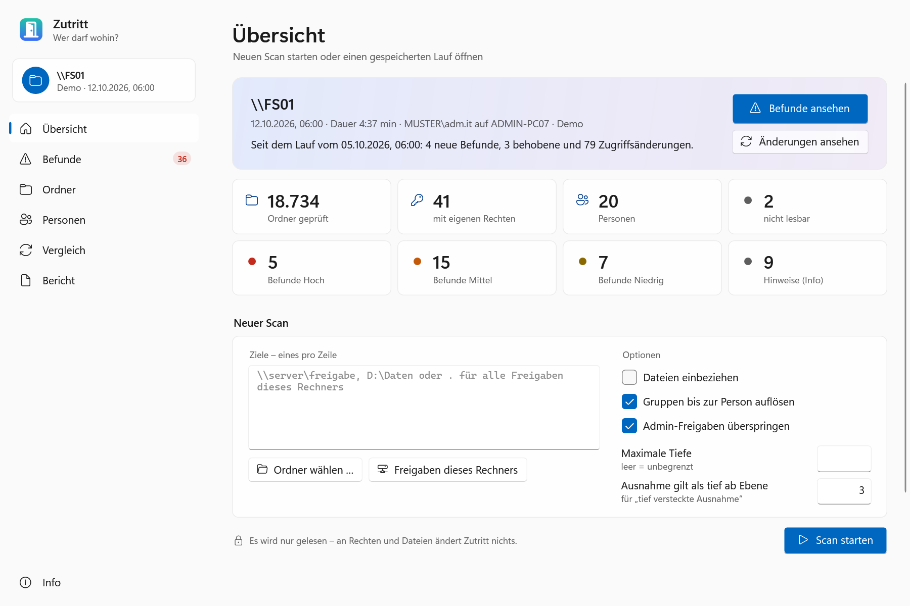
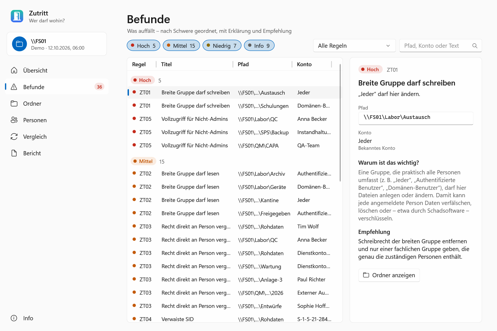
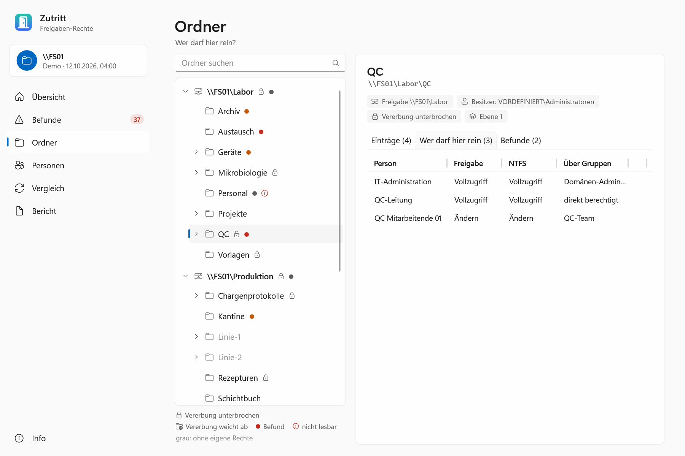
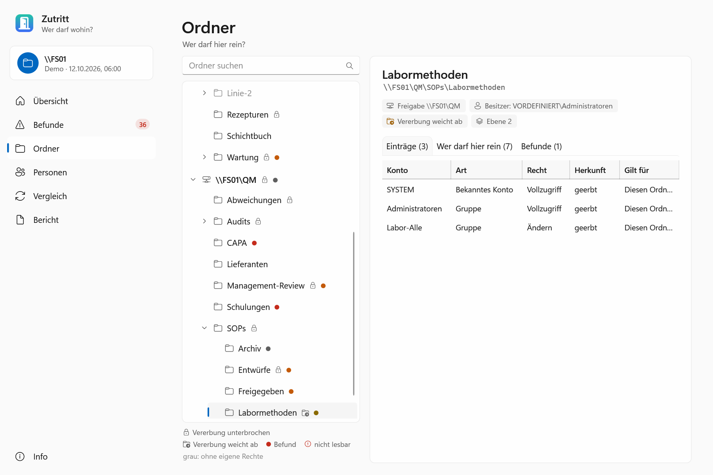
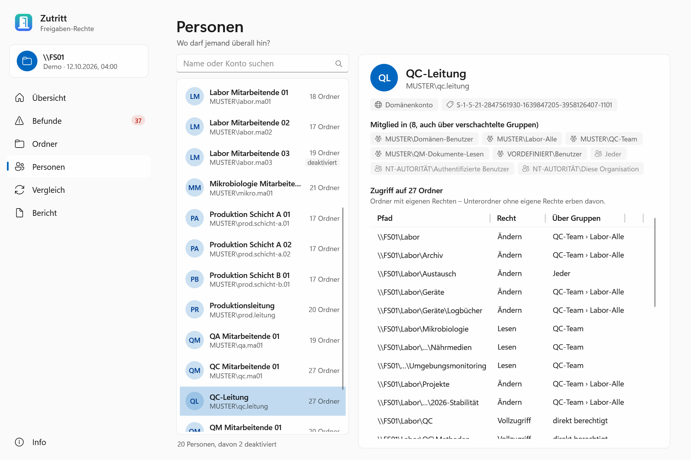
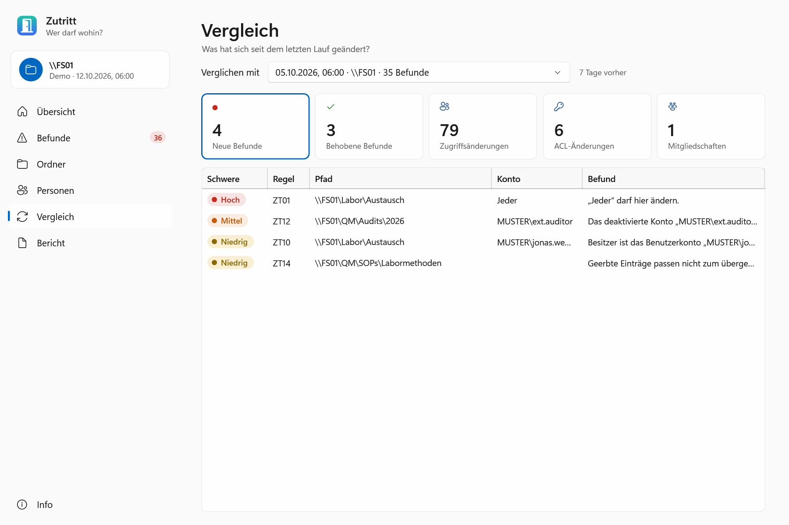
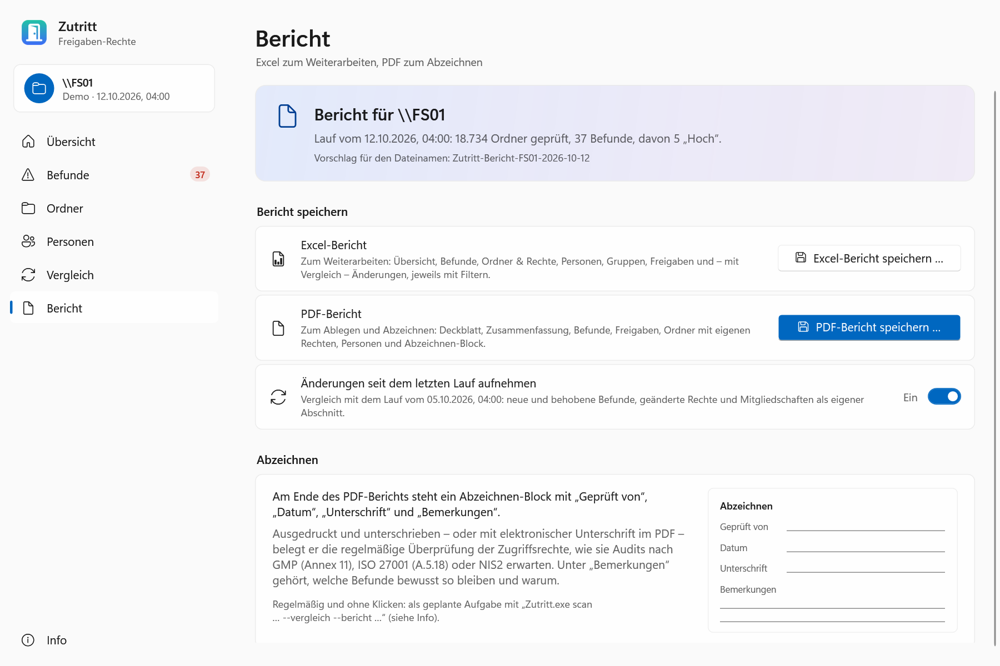
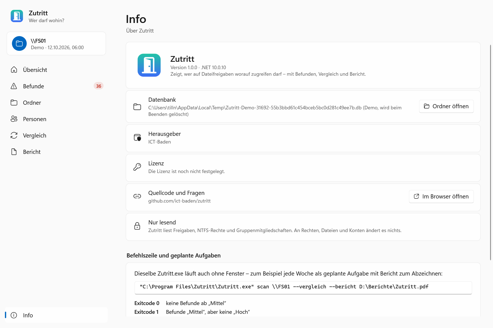

<a href="../README.md">Zutritt</a> › <a href="../README.md#documentation">Documentation</a> › Using the app

# Using the app

A walk through every page of the Zutritt window. The interface is German; each section names the German labels you will see, with a translation.

**Contents:** [Start and navigate](#start-and-navigate) · [Übersicht – scan and runs](#übersicht--scan-and-runs) · [Befunde – findings](#befunde--findings) · [Ordner – folders](#ordner--folders) · [Personen – people](#personen--people) · [Vergleich – comparison](#vergleich--comparison) · [Bericht – report](#bericht--report) · [Info](#info) · [Glossary](#glossary)

> [!NOTE]
> All screenshots show the built-in demo data (domain *MUSTER*, file server *FS01*). Start `Zutritt.exe --demo` to try every page without scanning anything; the demo uses a temporary database that is deleted when you close the window. The screenshots follow GitHub's light or dark theme; Zutritt itself follows the Windows setting.

## Start and navigate

Start Zutritt from the Start menu or by running `Zutritt.exe` without arguments. The window has a navigation bar on the left:

| Page | Meaning | Shortcut | What it answers |
|---|---|---|---|
| *Übersicht* | Overview | <kbd>Ctrl</kbd>+<kbd>1</kbd> | Start a scan, see the result at a glance, open earlier runs |
| *Befunde* | Findings | <kbd>Ctrl</kbd>+<kbd>2</kbd> | What is risky, why, and what to do |
| *Ordner* | Folders | <kbd>Ctrl</kbd>+<kbd>3</kbd> | *Wer darf hier rein?* – who can get in here? |
| *Personen* | People | <kbd>Ctrl</kbd>+<kbd>4</kbd> | *Wo darf jemand überall hin?* – where can someone go? |
| *Vergleich* | Comparison | <kbd>Ctrl</kbd>+<kbd>5</kbd> | What changed since an earlier run? |
| *Bericht* | Report | <kbd>Ctrl</kbd>+<kbd>6</kbd> | Save the Excel or PDF report |
| *Info* | About | <kbd>Ctrl</kbd>+<kbd>7</kbd> | Version, database location, command line |

<kbd>Ctrl</kbd>+<kbd>F</kbd> jumps to the search box of the current page. Above the navigation, a card shows the run that is loaded (*Kein Lauf geladen* = no run loaded); next to *Befunde* a badge shows the number of findings.

All pages show the **loaded run**. A run is one completed scan; it is saved and can be reopened at any time.

## Übersicht – scan and runs

<picture>
  <source media="(prefers-color-scheme: dark)" srcset="assets/screenshots/overview-dark.png">
  
</picture>

### Start a scan – *Neuer Scan*

1. Enter the targets under *Ziele – eines pro Zeile* (targets, one per line):

   | Target | Scans |
   |---|---|
   | `\\server\share` or `\\server\share\folder` | that share or a folder in it |
   | `\\server` | all disk shares of the server |
   | `D:\Data` | a local folder (or a whole drive with `D:`) |
   | `.` | all disk shares of this PC, through their local paths |

   *Ordner wählen …* (choose folder) adds local folders through a dialog, *Freigaben dieses Rechners* (shares of this PC) adds `.`.
2. Choose the options (*Optionen*):

   | Option | Meaning | Default |
   |---|---|---|
   | *Dateien einbeziehen* | Also record **files** with their own permissions. Takes considerably longer. | off |
   | *Gruppen bis zur Person auflösen* | Resolve local and – if reachable – Active Directory groups down to individual accounts. Without it, only accounts entered directly in ACLs appear as people. | on |
   | *Admin-Freigaben überspringen* | Skip `C$`, `ADMIN$`, `IPC$`, `print$` and other shares ending in `$`. | on |
   | *Maximale Tiefe* | Check at most this many levels below each target; *leer = unbegrenzt* (empty = unlimited). | empty |
   | *Ausnahme gilt als tief ab Ebene* | From which depth a broken inheritance counts as a *tief versteckte Ausnahme* (finding [ZT06](rules.md#zt06--deeply-hidden-exception)). | 3 |

3. Click **Scan starten**. A progress card shows the phase (*Ziele*, *Ordner*, *Konten*, *Befunde* – targets, folders, accounts, findings), the current path and the counts *Ordner gezählt* (folders counted), *mit eigenen Rechten* (with their own permissions) and *Fehler* (errors). *Abbrechen* cancels while targets, folders and accounts are processed; a cancelled scan is not saved. Once the findings are being evaluated, the scan is completed and saved.

When the scan finishes, Zutritt saves the run and immediately compares it with the **previous run with the same targets**, if there is one.

> [!NOTE]
> *Es wird nur gelesen – an Rechten und Dateien ändert Zutritt nichts.* – Only reading takes place; Zutritt changes no permissions and no files.

### The result

The banner names the targets, the time, the duration, who scanned on which PC, and – with a comparison – how many findings are new or resolved and how many access changes there are. *Befunde ansehen* opens the findings, *Änderungen ansehen* the comparison.

| Tile | Meaning |
|---|---|
| *Ordner geprüft* | Folders checked (all of them, plus files with *Dateien einbeziehen*) |
| *mit eigenen Rechten* | Folders stored because they have their own permissions – see [what gets stored](how-it-works.md#what-gets-stored) |
| *Personen* | User accounts that appear in the run |
| *nicht lesbar* | Folders or targets that could not be read |
| *Befunde Hoch / Mittel / Niedrig*, *Hinweise (Info)* | Findings per severity: high, medium, low, info |

### Earlier runs – *Letzte Läufe*

Below the form, the list of saved runs shows *Datum*, *Ziele*, *Ordner*, *Befunde* and *Gescannt von* (scanned by). Double-click a run or press <kbd>Enter</kbd> to open it (*Öffnen*); <kbd>Del</kbd> deletes it after a confirmation (*Lauf löschen*). Opening a run also compares it with its predecessor.

## Befunde – findings

<picture>
  <source media="(prefers-color-scheme: dark)" srcset="assets/screenshots/findings-dark.png">
  
</picture>

- **Filter:** the chips *Hoch*, *Mittel*, *Niedrig*, *Info* switch severities on and off; *Alle Regeln* filters by rule; the search box (*Pfad, Konto oder Text*) searches path, account and message.
- **List:** grouped by severity, with *Regel* (rule), *Titel*, *Pfad* (path) and *Konto* (account).
- **Detail:** the finding's message, the path, the account with its type (e.g. *Bekanntes Konto* = well-known account, *deaktiviert* = disabled, *Konto existiert nicht mehr* = account no longer exists, shown for orphaned SIDs), then ***Warum ist das wichtig?*** (why it matters) and ***Empfehlung*** (recommendation).
- ***Ordner anzeigen*** (show folder) – or a double-click on the row – opens the folder on the *Ordner* page.

What each rule means: [Rules reference](rules.md).

## Ordner – folders

<picture>
  <source media="(prefers-color-scheme: dark)" srcset="assets/screenshots/folders-dark.png">
  
</picture>

**The tree** contains the targets and every folder Zutritt stored – the folders with their own permissions. Levels in between appear grey (*grau: ohne eigene Rechte* – grey: no permissions of their own); they inherit unchanged from the nearest stored folder above. *Ordner suchen* filters the tree. The markers:

| Marker | Meaning |
|---|---|
| Padlock | *Vererbung unterbrochen* – inheritance is switched off |
| Folder with arrow | *Vererbung weicht ab* – inherited entries do not match the parent, probably moved ([ZT14](rules.md#zt14--permissions-differ-from-inheritance)) |
| Coloured dot | *Befund* – at least one finding; the colour shows the worst severity |
| Red exclamation mark | *nicht lesbar* – could not be read |

**The detail** of a folder shows chips for the share it is reached through (*Freigabe*), the owner (*Besitzer*), the inheritance state and the level (*Ebene*), and three tabs:

- ***Einträge*** (entries) – every ACE with *Konto* (account), *Art* (type), *Recht* (right), *Herkunft* (origin: *explizit* or *geerbt* = inherited) and *Gilt für* (applies to), in the words of the Windows dialog, e.g. *Diesen Ordner, Unterordner und Dateien*.
- ***Wer darf hier rein*** (who can get in here) – every person with effective access: *Freigabe* is the effective right when the folder is accessed through the share – the stricter of share permission and NTFS permission (*keine Freigabe* = not under a share, *nicht lesbar* = share permissions unreadable); *NTFS* is the right from the NTFS permissions alone; and *Über Gruppen* the group chain it comes through (*direkt berechtigt* = granted directly). A hint marks access reduced by a deny entry or a disabled account. If a broad group such as *Jeder* (Everyone) has access, a notice above the table says so (*Außerdem berechtigt: …*) – then practically every signed-in person can get in, including people not listed individually.
- ***Befunde*** – the findings for this folder, with *Schwere*, *Regel* and *Befund*.

### A moved folder

<picture>
  <source media="(prefers-color-scheme: dark)" srcset="assets/screenshots/folders-moved-dark.png">
  
</picture>

*Labormethoden* only has inherited entries – yet it is marked *Vererbung weicht ab*. The group *Labor-Alle* inherits *Ändern* (modify) here although the parent *SOPs* does not grant it: the folder was moved within the drive and kept the inherited rights of its old location. The finding [ZT14](rules.md#zt14--permissions-differ-from-inheritance) names the accounts that do not come from the parent.

## Personen – people

<picture>
  <source media="(prefers-color-scheme: dark)" srcset="assets/screenshots/people-dark.png">
  
</picture>

- **The list** contains every user account that appears in the run – in an ACL or as a member of a resolved group – with the number of folders it can access and a *deaktiviert* (disabled) tag. Search with *Name oder Konto suchen*. The caption counts people and disabled accounts.
- **The detail** shows the account type (*Domänenkonto* or *Lokales Konto*), the SID, ***Mitglied in*** (member of, including nested groups and implicit ones like *Jeder* and *Authentifizierte Benutzer*) and ***Zugriff auf N Ordner*** (access to N folders) with *Pfad*, *Recht* and *Über Gruppen*. A chain like *QC-Team › Labor-Alle* means: member of *QC-Team*, which is a member of *Labor-Alle*, which has the entry.

The table lists stored folders; subfolders without permissions of their own inherit the same right (*Ordner mit eigenen Rechten – Unterordner ohne eigene Rechte erben davon*).

## Vergleich – comparison

<picture>
  <source media="(prefers-color-scheme: dark)" srcset="assets/screenshots/comparison-dark.png">
  
</picture>

*Verglichen mit* (compared with) preselects the previous run with the same targets; you can choose any earlier run instead. If that run had different targets, a warning says that differences may come from that. The tiles select the list below:

| Tile | Lists |
|---|---|
| *Neue Befunde* | findings that are new in the loaded run |
| *Behobene Befunde* | findings that are gone |
| *Zugriffsänderungen* | people who can now access a folder with more or fewer rights (*Richtung*, *Vorher*, *Nachher* – direction, before, after) |
| *ACL-Änderungen* | ACL entries added, removed or changed, and folders that gained or lost permissions of their own (*Eigene Rechte neu* / *Eigene Rechte entfallen*) |
| *Mitgliedschaften* | group memberships added or removed |

How the comparison works: [How it works › Comparison](how-it-works.md#comparison).

## Bericht – report

<picture>
  <source media="(prefers-color-scheme: dark)" srcset="assets/screenshots/report-dark.png">
  
</picture>

- ***Excel-Bericht speichern …*** – the workbook to work with: every finding, every ACE, every person's access, with filters.
- ***PDF-Bericht speichern …*** – the document to file and sign, ending with the sign-off block (*Abzeichnen*).
- ***Änderungen seit dem letzten Lauf aufnehmen*** (include changes since the last run) adds the comparison currently selected on *Vergleich* as its own section. Without an earlier run the switch has nothing to include.

The file name is suggested as `Zutritt-Bericht-<target>-<date>`. After saving, *Öffnen* opens the file and *Im Ordner zeigen* shows it in Explorer. What the reports contain: [Reports](excel-and-pdf.md).

## Info

<picture>
  <source media="(prefers-color-scheme: dark)" srcset="assets/screenshots/about-dark.png">
  
</picture>

Version, the path of the database (*Datenbank*, with *Ordner öffnen*), publisher, source code link, *Nur lesend* (read-only), and a short introduction to the command line with the exit codes. *Lizenz: Die Lizenz ist noch nicht festgelegt.* – the licence has not been decided yet.

## Glossary

Terms you meet on every page and in the reports:

| German | English | Notes |
|---|---|---|
| *Lauf* | run | one completed scan, saved with an ID |
| *Ziel* | target | share, server, folder or `.` |
| *Befund* | finding | result of a [rule](rules.md) |
| *Schwere: Hoch / Mittel / Niedrig / Info* | severity: high / medium / low / info | |
| *eigene Rechte* | own permissions | explicit entries, broken or differing inheritance |
| *Vererbung unterbrochen / weicht ab* | inheritance broken / differs | |
| *Freigabe* | share | |
| *Besitzer* | owner | |
| *Kein Zugriff · Auflisten · Lesen · Schreiben · Ändern · Vollzugriff* | no access · list · read · write · modify · full control | the rights levels, see [How it works](how-it-works.md#rights-levels) |
| *Erlauben / Verweigern* | allow / deny | |
| *explizit / geerbt* | explicit / inherited | |
| *Jeder* | Everyone | |
| *Authentifizierte Benutzer* | Authenticated Users | |
| *Domänen-Benutzer* | Domain Users | |
| *VORDEFINIERT\\…* | BUILTIN\\… | e.g. *VORDEFINIERT\\Administratoren* |
| *NT-AUTORITÄT\\…* | NT AUTHORITY\\… | e.g. *NT-AUTORITÄT\\SYSTEM* |
| *ERSTELLER-BESITZER* | CREATOR OWNER | |
| *Verwaist / Unbekannt* | orphaned / unknown | see [identities](how-it-works.md#identities) |
| *Abzeichnen* | sign off | |

For well-known accounts – *Jeder*, *VORDEFINIERT\…*, *NT-AUTORITÄT\…* – Zutritt always uses the German names, so reports look the same on German and English installations. Domain groups keep the name they have in Active Directory.

---

<a href="installation.md">Installation</a> · <b>Using the app</b> · <a href="command-line.md">Command line</a> · <a href="rules.md">Rules</a> · <a href="how-it-works.md">How it works</a> · <a href="excel-and-pdf.md">Excel &amp; PDF</a> · <a href="data-and-privacy.md">Data &amp; privacy</a> · <a href="limitations.md">Limitations</a> · <a href="development.md">Development</a> 
<a href="../README.md">← Back to Zutritt</a>

